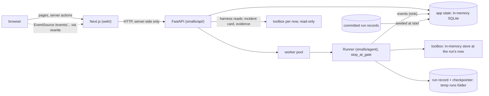

# Build plan: the web UI and its API

Ruling record and build plan, written on 2026-10-14 on branch `ui-build` (worktree `.claude/worktrees/ui-build`, cut from `agent-build` at `f3bb336`). It covers the work that section 2 of `docs/decisions/tools-agent-build.md` leaves to "the UI step": the API service with server-sent events, the web UI, and the resume compare-and-set that a web client needs. The screens are the approved v2 designs (section 4).

The agent track is still building on `agent-build` while this step runs. The two tracks share a commit history and a few files, and nothing else: section 3 says who edits what, and section 8 lists what the UI needs from the agent track, with what the UI does until each piece lands.

A fresh session builds from this file plus `docs/requirements.md`, PLAN sections 0, 3.1, 3.2 and 13, agent-design section 3 and axes 3, 4 and 8, and tools-agent-build sections 2, 5, 7.2 and 7.3. This record holds no incident content and no held-out content, so the agent track and the prompt author may read it.

## 1. Rulings (proposed 2026-10-14)

Each is ours to overrule. The build uses them as written until one is changed here.

| # | Point | Ruling | Why | Requirement served |
|---|---|---|---|---|
| U1 | Shape | Two processes. A FastAPI service, `smalls/api/`, imports the agent and the tools in process. A Next.js app, `web/`, renders every screen and talks only to that service. | The agent, its runner, its events and its gates are Python and were designed to be served this way (agent-design section 3, "Serving it later with FastAPI"). FastAPI gives typed request models and an OpenAPI document the web app generates its types from. | "A lightweight full-stack application" |
| U2 | State | The app's own state (chats, gate answers, notes, resolutions, write-ups, messages, knowledge-base entries, the event log) lives in one in-memory SQLite database, rebuilt at every start. The agent's run record and checkpointer stay as the agent track writes them, under a per-process temporary runs folder that is deleted at exit. | It keeps decision 11 of PLAN section 0: in process, nothing to install, nothing survives a restart. The run record is the agent's contract (replay, scorer, eval); writing it somewhere else would fork that contract. | "Memory / state management" |
| U3 | Concurrency | The API stays synchronous where it touches the agent. Runs execute on a small worker pool. A gate is a stop (`stop_at_gate`), never a blocked thread; the `Runner` for an active run is kept in memory and resumed from any worker under a per-run lock. Each run gets its own toolbox, because one store holds one clock. | The sync checkpointer fails under `ainvoke`, and a stopped run holds nothing while a person reads. The store's clock is per connection, so two runs at different `now` cannot share one. | "Failure handling" |
| U4 | One event stream | The browser receives the agent's events unchanged (`Event.to_sse`), numbered per chat, resumable with `Last-Event-ID`. One pure reducer in TypeScript folds events into what a chat shows; the server runs it for the first paint and the browser runs it live. | One vocabulary already feeds the terminal, the run record and replay. Folding it once, in one place, means a replayed chat and a live one render the same way. | "Practical UX" |
| U5 | Gate answers | The first answer wins: a decision names the interrupt it answers, and the API applies it only if that interrupt is still pending (compare-and-set in the app database); a second answer gets 409. A rejection needs a reason, which the agent already turns into an `ic:note` handle. | A double click, two tabs or a key held down must never resume a run twice. | "Agent orchestration" |
| U6 | Auto-approve | The switch is read when a run starts and becomes the run's policy (`by: auto`). Turned on while a run waits on reads, the API answers those read cards as the commander's standing choice. Actions always ask a person, whatever the switch says. Turning it off mid-run needs seam S6. | It matches the gate policy as built, and keeps the agent design's injection boundary: no text inside evidence can trigger an action without a person. | "Tool use" |
| U7 | Client and server boundary | Every `page.tsx` and `layout.tsx` is a server component with no client logic. Interactive parts are client components under `web/components/`, given serialisable props. Mutations go through server actions that validate their input. There is no `app/api/` route: route handlers are for external callers, and we have none. The event stream reaches the browser through a `rewrites` proxy to the API. The API's address and every key are server-only. | It keeps secrets and the backend out of the browser, keeps pages cheap to render, and keeps each interactive island small enough to test. | "Clean enough code to understand and extend" |
| U8 | No model after the report | The summary and the stakeholder messages are rendered by code from the final report, the commander's resolution and the evidence they kept. | The judgement is already in the report, validated and cited. Code keeps the write-up deterministic, free and testable, and adds no prompt text that would need its own blind pass. | "Where deterministic code is better" |
| U9 | Suggested follow-ups | The suggested questions after an answer are answered by code from the report, the verifier's verdict and the board, and say so: "From the report. No new reads." Free text while a run is live is an incident-commander note. | Most follow-ups ask what the report already holds. Answering them with a model call would be agent theatre. | "Useful agent behavior, not agent theater" |
| U10 | Nothing incident-specific in the UI | Every incident fact the UI shows comes from served data at `now` or from a run. The designs' sample data never enters code, fixtures or tests. The bundle-string lint extends to `smalls/api/` and `web/`. | The sample data in the designs is the incident's answer. Hard-coding any of it would fake the product and leak the answer into code the agent track reads. | "Grounded reasoning based on evidence" |
| U11 | Knowledge base | Saved entries live in the app database and are searchable in the UI. They are not served to the agent. | Serving them means changing the tool layer, which is the agent track's and falls under the held-out rule. A write-up of an incident, visible to a later run of the same incident, is a leak. | "RAG or retrieval" |
| U12 | A demo without a key | At start the API seeds every committed run record as a read-only chat. In replay mode it re-streams a committed run with its recorded timing and starts no run. Until the agent track commits a run (its row C3), development uses the scripted model. | PLAN 13: the quickstart a reviewer runs first is the replay of the hard investigation, with no key. | "Instructions to run the system locally" |
| U13 | Compose | `api` and `web` join `compose.yaml`, as ruling G2 foresaw. Only `web` publishes a port. The `web` service gets no `env_file`. `uv` and `pnpm` on the host stay the primary path. | The key never reaches the Node process, and the API is not reachable from outside the compose network. | "Instructions to run the system locally" |
| U14 | Design system | `tokens.css` and `bundle.css` are copied as they are. The components in `bundle.js` are rewritten as typed React with the same class names and props. No CSS framework is added. | The design system is already tokens and plain classes; a framework on top would be a second system to keep in step. | "An eye for design (UI)" |

## 2. In and out

**In.** The API: app database, run service, gates, notes, the event stream, read endpoints, evidence, seeding and replay. The web app: the shell, the dashboard, the chat and its three origins, the approval gate with its keyboard model, the evidence drawer, the answer card and working picture, the resolve dialog, the summary, the messages and the knowledge-base view. Accessibility checks, end-to-end tests, compose services, make targets.

**Out, with its owner.**

| Work | Owner | Starts when |
|---|---|---|
| The seams in section 8: changes to `smalls/agent/` and `smalls/tools/` | The agent track | Between its rows; each is small and independent |
| Live model runs, and committing the run the demo replays | The agent track (rows C3, C4), with a go-ahead | As that track schedules them |
| Saved knowledge-base entries feeding `search_knowledge` | A later step, with a ruling (U11) | After the held-out runs |
| Sign-in, several users, persistence across restarts | Not in v1: one person on their own machine | The production path in the write-up |
| Writing to ServiceNow, Slack or a status page | Not in v1: the UI copies text, it sends nothing | Never in this take-home |
| A phone layout beyond the designs' own responsive rules; the v1 and exploration boards | Not in scope | n/a |

## 3. Session rules

**Who edits what.** This step edits only:

- `web/`, `smalls/api/`, `tests/api/`, this record;
- a new lint module beside `smalls_data/prompt_lint.py` (section 7.6);
- shared files, in small blocks of their own: `pyproject.toml` and `uv.lock` (a dependency group `api`), `Makefile` (a block of new targets at the end), `compose.yaml` (two new services), `.gitignore`, `.dockerignore`.

It never edits `smalls/agent/`, `smalls/tools/`, `smalls/contracts/`, `eval/`, the five blind files or any existing make target. What it needs there is a seam request (section 8). On a rebase, `uv.lock` takes the other side and is regenerated with `uv lock`.

**Held-out rule.** This step does not write the agent, so the rule's restrictions on editing do not bind it, but it never reads or lists `eval/heldout/`, `scenario/variants/` or `bundles/h*/`, and repository searches exclude them. It reads no `_internal/` folder and nothing under `scenario/`. The API never opens either: it reads served data through the toolbox and the store, which refuse them, and the checkpoint's trigger file, which the harness already reads.

**The designs hold the answer.** Their sample data (the prototype rows, answers, evidence lists, notes and drafts) is this incident's solution. Read it for shape. None of it goes into code, fixtures, tests, placeholders or commit messages, and the design files are not committed. The one incident string inside the design system's components (a placeholder) is replaced with generic text in the port.

**Runs.** Development runs use the scripted profile. A live model run spends money and needs a go-ahead, as on the agent track.

**Commits.** Small, one per row or less, local on `ui-build`. The branch carries `agent-build`'s unpushed commits, so it is pushed when that one is. When `agent-build` lands a seam this step needs, this branch rebases onto it.

## 4. The designs

The approved designs are the v2 boards of the Smalls prototype, a private Design canvas: `https://claude.ai/artifact/85uhYbVpD6WA3XSnh1N8Tn`. Read them with the Artifact tool, never with WebFetch or curl, into the session's scratchpad, not the repository:

```text
Artifact({ action: "read", url: "https://claude.ai/artifact/85uhYbVpD6WA3XSnh1N8Tn",
  paths: ["project/canvas.json", "project/DashboardV2.dc.html", "project/ChatV2.dc.html",
          "project/ChatHeadlessV2.dc.html", "project/ChatNewV2.dc.html", "project/SummaryV2.dc.html",
          "project/MessagesV2.dc.html", "project/Evidence.dc.html", "project/ds/smalls/tokens.css",
          "project/ds/smalls/tokens.json", "project/ds/smalls/components/bundle.css",
          "project/ds/smalls/components/bundle.js", "artifact-type/reference/format.md"] })
```

`format.md` says how to read a `.dc.html` board: the markup inside `<x-dc>` is the template, `{{holes}}` come from `renderVals()`, `<sc-if>` and `<sc-for>` are conditions and loops, `<x-import component-from-global-scope="Smalls.X">` mounts a design-system component (kebab-case attributes become camelCase props), `<dc-import>` mounts another board, and the `<script data-dc-script>` class holds the prototype's state. To click through, open the URL, switch to the Flow v2 page and press Play.

| File | Board | Contents |
|---|---|---|
| `DashboardV2.dc.html` | 1 | Incident card, agent panel (idle, running, finished), chats list, knowledge-base band |
| `ChatV2.dc.html` | 2 | Every chat screen; its `origin` prop is `chat`, `headless` or `blank` |
| `ChatHeadlessV2.dc.html` | 2b | The chat opened from an agent run |
| `ChatNewV2.dc.html` | 2c | A new, empty chat |
| `SummaryV2.dc.html` | 3 | The write-up beside its evidence rail |
| `MessagesV2.dc.html` | 4 | Stakeholder messages and the knowledge-base entry |
| `Evidence.dc.html` | – | The evidence drawer that boards 2 to 4 open from any handle; the only non-v2 board in scope |
| `ds/smalls/*` | – | Tokens, light and dark themes, and the components |

Only boards with `"page": "v2"` in `canvas.json` are in scope, plus `Evidence.dc.html`. The sticky notes `v2dash`, `v2chat`, `v2sum` and `v2msg` state each screen's intent. Out of scope: `Dashboard`, `DashboardAlt`, `Chat`, `ChatHeadless`, `ChatNew`, `Summary`, `Messages`, `ChatGates`, `ChatMobile`, `Main`, `Report`, `Timeline`, `Resolved`. The approval gate in `ChatV2` is custom markup and does not use the `ToolGate` component.

What the designs specify, condensed; the boards are the authority on detail.

- **Every screen.** An app bar with the brand, a Dashboard link and "New chat". An incident bar: a P1 pill, the title, a status tag, and a mono meta line in UTC. A stepper, Investigate → Summary → Messages: before resolution Summary and Messages are plain text; after it, done steps show ✓ and every step is a link; the current step is highlighted. Amber with ◆ means "needs you" and nothing else; investigating uses the neutral tag; red is for the P1 pill, Reject and the "Don't" row. Times are UTC in mono. Any handle opens the evidence drawer, 560 px wide on the right. One primary button per region; links styled as buttons are 32 px high like the Button.
- **Dashboard.** The incident card with tags, title, a facts grid and the latest work note in full. The side panel: idle (Investigate in chat, primary, or Run agent), running (elapsed, progress, a step list marked ✓ › ○, Stop) and finished (the summary, hypothesis rows with Confidence, "Open findings in chat", "Run again"). The chats list, with Resume primary on a chat waiting on reads. The knowledge-base band.
- **Chat.** A conversation column of at most 920 px and a sticky "Working picture" aside of 320 to 400 px. Before sending, an intro above an inline message box (prefilled with the commander's note in the `chat` origin, button "Start investigation"); after sending, the box docks with "Ask next" chips. While reads wait, Send is disabled and the hint becomes an amber link, "◆ N reads are waiting for you above", to `#pending`.
- **The approval gate.** Header "◆ N reads need your approval", "Read-only. Nothing runs until you choose." and a key legend. Each row: the tool in mono, the reason, parameter chips, "Show query". Actions on the right: Approve (primary when one read waits, secondary when several do), Edit (editable reads only; a parameter form with "Approve with edit"), Skip, Reject… (quick reasons and an input; a reason is required). The batch footer comes after the rows. A decided row collapses to a receipt: ✓, – or ✕, the tool, the receipt text, a handle and "Show result". The gate title becomes a summary such as "2 reads · 1 run, 1 rejected".
- **Keys.** A approve, E edit, S skip, R reject, Shift+A approve all, Shift+S skip all, Enter and Esc confirm and cancel inside the edit and reject inputs. Handled on the gate and its rows, never page-wide; ignored while typing, with Ctrl, Cmd or Alt, and on repeat. After any decision, send or follow-up, focus moves to the waiting gate's target Approve unless the person is typing. The gate and rows are focusable (`tabindex="-1"`). Buttons carry `aria-keyshortcuts` and a tooltip such as "Approve (A)". The legend is hidden on touch devices.
- **Answer card,** when the leading confidence is 0.7 or more: a lead sentence, then Cause; How sure (the `leading` tag and Confidence with a tick at the previous value); Do next, bold; Owner; Don't, red label; Evidence handles. Below 0.7: the lead, a narrative and handles. Then a "Findings updated" strip with "Mark resolved…".
- **Working picture.** In play: statement first, then status tag, role and Confidence (the tick marks where the claim started). Ruled out: struck through, muted confidence. A tally: reads proposed, run, rejected, skipped.
- **Origins.** `headless`: a banner ("Agent run · finished in N s · N reads, none needed approval") and a ServiceNow ticket card in place of the commander's message; auto-approve on. `blank`: a "New chat" intro; the header says "Not linked to an incident yet".
- **Resolve dialog.** "Who found the fix?": Smalls' conclusion was right, or I resolved it another way; the conclusion shown for the first. A required note, resolved at (UTC), resolved by. "Continue to summary" stays disabled until there is a note. "Nothing is saved or sent yet."
- **Summary.** Write-up: how it was resolved (with Edit); what happened (a narrative and a Cause → Trigger → Mechanism → Impact chain with handles); the signals that mark this issue; ruled out. Evidence rail: checkboxes, "Keep all", "Clear", a kept count; a signal with none of its evidence kept shows "Left out" in amber; the `agent` path keeps everything, `own` starts with nothing. A sticky bar: "Save to knowledge base" (disabled without a note), "Refine in chat", "Regenerate", a version line; after saving, "✓ Saved to the knowledge base" and "Draft stakeholder messages"; any edit unsaves.
- **Messages.** Audience list with Draft, Edited or ✓ Copied and its checks result; the knowledge-base entry apart, under "Not sent"; "N of 4 copied" and a four-segment bar. The card: audience, channel, a guide line, "Restore draft" (disabled until the text changes), "Copy message" (primary), the textarea, a word count, and checks beside it, failing first, updated as you type. "Copied" is tied to the exact text copied. The knowledge-base view: the read-only entry, "What would bring it up" search terms, and a preview of how it shows in a later search.
- **Accessibility.** Real `button`, `a`, `label` and `input` elements; `aria-current` on nav items and steps; `aria-live` on the agent panel, the save bar, the checks panel and the Copy button; focus rings use `--focus-ring`.

## 5. Architecture



| Process | Listens | Holds | Never holds |
|---|---|---|---|
| API, `uv run --env-file .env uvicorn smalls.api.app:app` | `127.0.0.1:8000` on the host; the compose network only in a container | The model keys, the app database, the runs | Anything the browser can read directly |
| Web, `pnpm --dir web dev` (or `start` after a build) | `localhost:3000` | `SMALLS_API_URL`, server-side | Any key; the API's address in client code |

**Modes.** `SMALLS_API_MODE` is `live` (the configured profile; a key is needed), `scripted` (the scripted model with a generic script, no key) or `replay` (no run starts; committed runs replay). The checkpoint is `SMALLS_CHECKPOINT`, default the Makefile's `CHECKPOINT`; the bundle is `SMALLS_BUNDLE`. `/capabilities` tells the web app the mode and which seams exist, and the UI hides what is not available rather than failing.

## 6. The API

### 6.1 App database

`sqlite3.connect(":memory:", check_same_thread=False)`, one connection behind a lock, schema created at start. Rows are small; the event log is the largest table.

| Table | Rows |
|---|---|
| `chat` | id, origin (`chat`, `headless`, `blank`, `replay`), title, incident number or null, `now`, created, auto-approve, status |
| `run` | id, chat id, the agent's run id, trigger, status (`running`, `paused`, `completed`, `incomplete`, `stopped`), started, finished, the folder of its record |
| `event` | chat id, `seq` (per chat), run id, the agent's `seq`, type, data (JSON), `t_wall` |
| `gate` | chat id, run id, interrupt id, round, cards (JSON), asked at, decided at, answers (JSON), standing (answered by the auto-approve switch) |
| `note` | chat id, run id, text, submitted at, delivered at |
| `resolution` | chat id, path (`agent` or `own`), note, resolved at, resolved by |
| `writeup` | chat id, version, kept handles (JSON), rendered body (JSON), saved at |
| `message` | chat id, audience, draft, text, copied hash |
| `kb_entry` and `kb_fts` (FTS5) | id, chat id, title, body, search terms |

### 6.2 Run service

- A run starts with `Runner(cfg, toolbox, sinks=[AppDbSink], stop_at_gate=True, attended=True)` from `load_config(runs_dir=<temp>, interactive=not auto_approve)`, then `start(trigger, now, checkpoint=...)`, on a worker. The toolbox is `bundle_toolbox(bundle)`, built for that run.
- `AppDbSink.emit` writes the event to `event` and wakes the chat's listeners. The agent's own `events.jsonl` is still written; the app copy is what the browser reads.
- `run_paused` writes a `gate` row with the pending cards. The Runner object stays in a dict keyed by run id; nothing runs until an answer arrives.
- `POST /chats/{id}/gate` carries `interrupt_id` and one answer per call id: `{approve: true}`, `{approve: true, args: {...}}` (S2), `{defer: true}` (Skip) or `{approve: false, reason}` (Reject), plus an optional note. The API marks the gate decided with a conditional update; if no row changed, it answers 409. Otherwise it calls `runner.resume(answers, note)` on a worker under the run's lock.
- With the auto-approve switch on, a new gate whose cards are all reads is answered at once as a standing approval; a card that is an action is always left for a person.
- `POST /chats/{id}/notes` delivers a note: with the next resume when the run is paused, through S4 while it runs, and as a follow-up (section 7.5) once it has finished.
- `POST /chats/{id}/stop` calls S5 when it exists.
- Shutdown stops accepting runs, lets paused runs go (they are lost by design, U2) and deletes the temp folder.
- In scripted mode the profile is `scripted` with a generic script in `smalls/api/devscript.py`: it reads, cites handles it was shown, proposes one generic action, updates the board and submits. It knows nothing about the data, like the script in `tests/agent/test_agent_real_tools.py`, and the bundle-string lint covers it.

### 6.3 The event stream

`GET /chats/{id}/events`, `text/event-stream`. It sends every stored event with `seq` greater than `Last-Event-ID` (or the `after` query), then live ones as they are written, each as `id:`, `event:` and `data:`. A comment line every 15 s keeps proxies open. Headers: `Cache-Control: no-cache, no-transform`, `X-Accel-Buffering: no`. Starlette's `StreamingResponse` is enough; no extra dependency.

### 6.4 Endpoints

| Method and path | Returns or does |
|---|---|
| `GET /health`, `GET /capabilities` | Liveness; the mode, the checkpoint, `now`, and which seams exist |
| `GET /incident` | The incident card: the ServiceNow incident version visible at `now` (priority, number, state, service, group, CI, opened, assignee), the commander's note from the checkpoint's trigger file (author and time from its header). Which incident: the one the trigger belongs to, found from served data; if the data cannot say, a config value names it. No derived fact (first errors, cause) appears here. |
| `GET /chats`, `POST /chats` | The list with status and counts; create a chat (`origin`, trigger, auto-approve) and start its first run |
| `GET /chats/{id}` | Chat, runs, events so far, resolution, write-up, messages |
| `GET /chats/{id}/events` | The stream (6.3) |
| `POST /chats/{id}/gate`, `/notes`, `/stop`, `/runs` | Answer a gate; add a note; stop; start another run in the chat |
| `GET /chats/{id}/calls/{call_id}` | What a call showed: the rows from `evidence.jsonl` with their handles, and from `calls.jsonl` the arguments, native query, window and status |
| `GET /chats/{id}/evidence/{handle}` | The drawer: source, the native record through `get_record` at the chat's `now` (shown through `store.render_native`), event and known times in UTC with the time as the vendor wrote it, the native query that reproduces it, related records (parent, children, referenced), the claims that cite it, and any clamp |
| `GET /tools/schemas` | Each read tool's argument schema, for the Edit form |
| `PUT /chats/{id}/resolution`, `PUT /chats/{id}/writeup`, `POST /chats/{id}/writeup/save`, `PUT /chats/{id}/messages/{audience}`, `POST /chats/{id}/messages/{audience}/copied` | The steps after an investigation |
| `GET /kb?q=` | Knowledge-base search over saved entries |

Every request body is a pydantic model with length limits. Errors are `application/problem+json`. There is no CORS middleware, because the browser never calls the API directly.

### 6.5 Seeding and replay

At start the API reads each committed `eval/runs/<id>/` that has a `report.json` and makes a `replay` chat from its `events.jsonl`, with its calls, evidence and report. In replay mode, "Run agent" re-streams the newest committed run's events into a new chat at its recorded pace (a speed factor, default 4×), labelled as a replay of that run and its date. No model is called and no key is read.

## 7. The web app

### 7.1 Stack

Next.js 16 (App Router, Turbopack), React 19, TypeScript strict, pnpm. Exact versions are pinned at install (16.4.0 and 19.3.0 were current on 2026-10-14). ESLint with the Next config, Vitest for pure modules, Playwright with `@axe-core/playwright` for the browser, `openapi-typescript` for the API's types, `zod` in server actions. Fonts through `next/font/google` (IBM Plex Sans and Mono), so the browser makes no request to Google.

### 7.2 Layout

```text
web/
  app/
    layout.tsx                    server: fonts, tokens, theme from a cookie, app bar
    page.tsx                      dashboard
    chats/new/page.tsx            blank origin
    chats/[id]/page.tsx           chat (origin from the chat row)
    chats/[id]/summary/page.tsx
    chats/[id]/messages/page.tsx
    loading.tsx, not-found.tsx, error.tsx (thin; the framework requires error.tsx to be a client file)
  components/
    ds/                           the design-system port (7.4)
    shell/  dashboard/  chat/  gate/  evidence/  summary/  messages/
  lib/
    api.ts                        server-only typed client ("server-only" import)
    api-types.ts                  generated from the API's OpenAPI; never edited by hand
    actions/                      server actions ("use server"), one file per area
    chat/reduce.ts                the event reducer (pure, no React)
    chat/answers.ts               the follow-up answers (pure)
    writeup/render.ts             summary and messages rendering and checks (pure)
    events.ts                     the client EventSource hook
  styles/tokens.css, styles/bundle.css
  next.config.ts                  rewrites: /events/:id -> ${SMALLS_API_URL}/chats/:id/events
```

### 7.3 Rules the build checks

- No `"use client"` in any `app/**/page.tsx` or `layout.tsx`; no `app/api/` folder; no `NEXT_PUBLIC_` variable; no `dangerouslySetInnerHTML`. A script in `web/scripts/` checks these and runs in `pnpm lint`.
- `lib/api.ts` imports `server-only`. After `pnpm build`, the client assets under `.next/static` contain neither the value of `SMALLS_API_URL` nor the name of any key variable; a check fails the build otherwise.
- Every page renders per request; nothing caches app state. A server action revalidates the paths it changed.
- Evidence text, log lines and chat messages are untrusted: rendered as text, highlights built by splitting strings into spans, never parsed as HTML or Markdown.
- `api-types.ts` is regenerated by `make api-types`; a check fails when it differs from the running API's schema.

### 7.4 Design-system port

`bundle.js` holds about twenty components (Button, Toggle, Handle, Handles, StatusTag, Confidence, Notice, Question, CheckpointBar, Params, ToolGate, ToolResult, EvidenceRecord, ConflictPair, ImpactSummary, HypothesisCard, Timeline, ActionList, AvoidList, CoverageTable, StakeholderMessage). Port the ones the v2 boards and the drawer mount, as typed React with the same props and class names. A component with no state or handlers is a server component; one with handlers is a client component. Theme is `data-theme` on `<html>`, read from a cookie on the server so there is no flash, with the system preference as the default.

### 7.5 Where each screen gets its data

| Element | Source |
|---|---|
| Incident card and bar | `GET /incident`. After a report exists, the meta line can add the first timeline row's time, with its handle. |
| Agent panel, running | `run_started` (elapsed), `phase`, `tool_call_proposed` and `tool_result` (the step list: the call's `rationale.tests` while it runs, its receipt when done) |
| Agent panel, finished | The `report` event (summary, hypotheses with status and confidence) and the run's `summary.json` (wall time, reads, gates) |
| Chats list | `GET /chats`: waiting (paused, with the count of pending cards), running, finished, resolved |
| Narrative between gates | The round's `thinking` event: the first paragraph, expandable to the whole. Visible `text_delta` when a provider sends it. |
| Gate row | The `gate_pending` card: tool, `rationale.tests` and `expect` as the reason, arguments as chips. "Show query": the native query when the card carries it (S7), else the arguments. |
| Receipt | `gate_decision` plus `tool_result`: rows and size, the first row's text, its handle, and the board change that followed the call (the per-call hypothesis delta PLAN 13 asks for) |
| Show result | `GET /chats/{id}/calls/{call_id}` |
| Answer card | The report. Lead: the summary's first sentence. Cause: the leading hypothesis. How sure: its confidence, with the tick at its first history value. Do next: action rank 1. Owner: that action's owner, else `impact.oncall`. Don't: `do_not`. Evidence: the leading hypothesis's support handles. |
| Working picture | `hypothesis_update` events: in play is leading and open, ruled out is rejected; tick at the first value |
| Tally | Proposed from `tool_call_proposed` (agent reads only), run from ok results, rejected, and skipped (deferred) from `gate_decision` |
| Follow-up chips | `lib/chat/answers.ts` over the report, verdict and board (U9): "Why not …?" for each rejected hypothesis (its `against` evidence), "What would change your mind?" (the verifier's alternatives and their checks), "Who should own it?" (owner, on-call evidence), "Draft the exec update" (the stakeholder update) |
| Headless banner | `summary.json` and the gate log |
| Summary | `lib/writeup/render.ts` over the report, the resolution and the kept handles: How it was resolved (the note); What happened (the summary and the chain by role: cause, trigger, contributing, then impact, see Q6); Signals (each `this_incident` alert verdict and each timeline row, with their handles); Ruled out (rejected hypotheses with `against`). Under the `own` path the chain is titled as Smalls' last picture, not as what fixed it. |
| Messages | The same module: one draft per audience from `stakeholder_update` and the report, and checks that are generic and take their values from the report (the owner named, a UTC time, the next update time, a length limit, no handle, no host or entity name in public text, `do_not` for engineers) |
| Knowledge-base view | The saved entry; search terms from the report (subject, entities, alert titles, tags when on); the preview is a real `GET /kb` search for those terms |

### 7.6 The lint

`smalls_data/ui_lint.py` takes `bundle_strings()` from `smalls_data/prompt_lint.py` and scans every source file under `smalls/api/` and `web/` (not `node_modules`, `.next` or generated types) for those strings. It runs in `make lint`. Test fixtures are synthetic (section 9, row R9), so they pass it too.

## 8. What the UI needs from the agent track

Each seam is mechanical code. None changes a blind file: wording the model sees in a seam is mechanical output, which the build session writes (tools-agent-build section 3). Until a seam lands, the UI uses the fallback and `/capabilities` says which is in force.

| # | Seam | Shape | Until it lands |
|---|---|---|---|
| S1 | Decisions from the web are recorded as `via: web` | `RunContext.via` set by the caller; the state's `via` type gains `web` (the report's `GateBy` already has it); the human branch of the gate uses `ctx.via` | Decisions are recorded `via: cli`; the app database knows they came from the web |
| S2 | Approve with edit | A resume answer `{approve: true, args}`, validated against the tool's argument model; the tool runs with the edited arguments; the gate log and `calls.jsonl` keep both; the result's first line says the commander edited the arguments | Edit is hidden |
| S3 | Reopen a finished run with a note | `Runner.reopen(note, calls=revision_calls)`: the note becomes an `ic:note` row, the investigator gets more gated calls and resubmits; history rows and the verifier's changed-claims re-check work as after a revision | Q2 |
| S4 | Notes while a run is running | A thread-safe inbox on the Runner, drained into `ic_notes` at the next round | The API holds the note and delivers it at the next pause, with the gate answers |
| S5 | Stop | `Runner.request_stop()`, checked between stream parts; the run ends `paused`, resumable, with its partial board | Stop is hidden; the panel says the run ends within its budget |
| S6 | Auto-approve off mid-run | A switch the gate node reads each round | Turning it off mid-run applies to the next run, and the switch says so |
| S7 | The native query before a read runs | The gate card carries the native query and the resolved window (agent-design axis 3: "read cards show the resolved window and native query"), if the tool layer can render them without running | "Show query" shows the arguments; the receipt shows the native query once the read has run |

## 9. Build order and acceptance

One sequence. Each row is committed when its acceptance passes; evidence goes in the row's line in this table or in section 12.

| # | Build | Accepted when |
|---|---|---|
| R0 | Baseline in the worktree | `make test` and `make lint` pass at the cut commit; the numbers are recorded here |
| R1 | API skeleton: dependency group `api` (FastAPI, uvicorn), the app factory, settings, the app database (6.1), `/health`, `/capabilities`, problem responses, `make api` | Pytest with the test client; two starts give identical empty databases; nothing is written under the repository |
| R2 | Run service (6.2) with gates, compare-and-set, notes, auto-approve (U6) and the scripted dev script | A scripted run over the agent track's fixture registry pauses at a gate and resumes on an answer; a second answer gets 409; a rejection's reason is in the run's `notes.jsonl`; an action card is never answered by the switch; after shutdown the temp folder is gone |
| R3 | The event stream (6.3) | A client that disconnects mid-run and reconnects with `Last-Event-ID` receives every `seq` exactly once and in order |
| R4 | Read endpoints (6.4): incident, chats, calls, evidence, tool schemas | At 14:40 and 14:52, a test calls every endpoint and finds no timestamp at or after `now` (reusing the leak test's scanner) and no opened path under `_internal/` or `scenario/`; an unknown handle is a 404 problem |
| R5 | Seeding and replay (6.5) | A run record written by R2's scripted run, seeded as a replay chat, yields the same event list as the live chat |
| R6 | Web skeleton (7.1 to 7.3), the rewrite, the theme cookie, generated types, the boundary checks, the lint (7.6) | `pnpm build` is clean; the checks pass; the built client assets hold no API address and no key name; through the rewrite on port 3000, events arrive one by one (`curl -N`), not in a burst at the end |
| R7 | Design-system port (7.4) | Each ported component renders in both themes; a screenshot of each beside its prototype board is recorded in section 12 |
| R8 | Shell and dashboard | Run agent (scripted) goes from idle to running to finished live; a reload mid-run restores the panel; a paused chat shows amber "Waiting on N reads" with Resume as the primary button |
| R9 | Chat transcript: the reducer, the intro and composer, the commander's turn, narrative per round, the working picture, the tally | Vitest over event logs from scripted runs on the fixture registry, committed under `web/tests/fixtures/` by `make api-fixtures` (synthetic, so the lint passes); the server's first paint equals the client's fold of the same events |
| R10 | The approval gate: rows, chips, query, Approve, Edit (S2), Skip, Reject with reasons, the batch footer, receipts, Show result, the keyboard model, focus, `aria-keyshortcuts`, the touch legend, Send disabled with the amber link | A Playwright suite covers each key, the ignore rules (typing, modifiers, repeat), Enter and Esc in the inputs, focus on the target Approve after every decision, Shift+A and Shift+S, and a double submit that records one decision |
| R11 | Evidence drawer | Every handle in a scripted chat opens a record; Esc closes it and returns focus; no time at or after `now` is shown; a handle that does not resolve shows the error notice |
| R12 | Answer card, findings strip, follow-ups (U9, Q2), notes, the headless and blank origins | Reports at 0.69 and 0.70 render each form; each chip's answer cites only handles the run showed |
| R13 | Resolve dialog and summary | Continue is disabled until there is a note; the `agent` path keeps everything and `own` nothing; unticking a signal's last record shows "Left out"; saving, then any edit, unsaves; Regenerate bumps the version |
| R14 | Messages and the knowledge-base view | Checks update on each keystroke, failing first; Copy writes the clipboard and marks that exact text copied; an edit clears it; Restore draft is enabled only after a change; "N of 4 copied" counts right; the preview finds the saved entry by its terms |
| R15 | Accessibility and the whole flow | Axe finds nothing on every page in both themes; the flow from the dashboard to messages runs with the keyboard alone; one Playwright test runs it in scripted mode |
| R16 | Compose and commands: `api` and `web` services; `make app` (both, on the host), `make app-demo` (replay mode), `make api-types`, `make api-fixtures`, `make web-test` | The flow test passes against `docker compose up`; the `web` container's environment holds no key |
| R17 | Docs | This record holds every row's evidence and every judgment call; the HANDOFF section is drafted in section 12 and applied when the branches meet |

If time runs short, cut in this order: the knowledge-base preview, Regenerate, the touch legend, replay pacing (replay at once instead). Never cut the compare-and-set, the boundary checks, the lint, the keyboard model or the evidence drawer.

## 10. Done means

- `make app` with a key, or `make app-demo` without one, opens the dashboard on `localhost:3000`.
- From the dashboard, a person can investigate in chat, approving reads one at a time with the keyboard, or run the agent and open its findings, and get the cause, how sure, what to do, who owns it and what not to do from the answer card.
- Any handle anywhere opens its native record in the drawer, and nothing shown is later than `now`.
- A gate answered twice, from two tabs or by a held key, resumes the run once.
- Resolving leads to a summary built from the kept evidence and to four messages whose checks pass, each copied with one click.
- No key and no backend address reaches the browser; no page or layout carries client logic; there is no API route.
- No incident string appears in `web/` or `smalls/api/`, and nothing in the UI is hard-coded from the designs' sample data.
- A restart leaves nothing behind.

## 11. Open points

Each has the answer the build uses meanwhile.

| # | Point | Meanwhile | Why |
|---|---|---|---|
| Q1 | Gate expiry. Agent-design axis 3 says a UI gate times out to `deferred` after about 90 s; the v2 dashboard shows chats waiting on reads until the commander resumes them. | No expiry: a waiting gate stays waiting. | A gate is a stop and holds nothing, and the design treats a waiting chat as normal. The 90 s figure assumed a blocked thread. |
| Q2 | Free-text follow-up after a run has finished, before S3. | The chips answer from the report; free text offers "Start a new run with this note", which runs again from the original trigger plus the note, as a new run in the same chat. | Honest about cost, and useful today. |
| Q3 | PLAN 13 asks for a timeline and the 14:40 to 14:52 difference; the v2 boards show neither as such. | The report's timeline as an expandable list under the answer card and in the summary's "What happened"; the difference as the Confidence ticks and the "Findings updated" strip; receipts show per-call board changes. | It meets PLAN 13 without a screen the designs did not ask for. |
| Q4 | "Read N of 5" assumes a fixed number of reads; a real run has a budget and stops when ready. | Progress by phase (orient, sweep, investigate, report, verify) and the reads listed as they happen, with no denominator. | A bar that fills to the budget would be wrong on every run that stops early. |
| Q5 | Pushing `ui-build`. | Local until `agent-build` is pushed. | Pushing would publish the agent track's commits from here. |
| Q6 | The chain's "Mechanism" step: the report has no mechanism role. | Cause, Trigger and Impact from their sources; the third step shows contributing hypotheses under the label "Contributing". | Adding a role is a report-schema change on the agent track. |

## 12. Judgment calls made while building

Empty until the build starts. Number them N1, N2 and so on, each with the design text or rule it interprets and the concrete form chosen.
