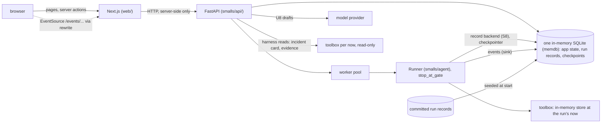

# Build plan: the web UI and its API

Ruling record and build plan, written on 2026-10-14 on branch `ui-build` (worktree `.claude/worktrees/ui-build`, cut from `agent-build` at `f3bb336`, with `main` merged in at `904c686`). It covers the work that section 2 of `docs/decisions/tools-agent-build.md` leaves to "the UI step": the API service with server-sent events, the web UI, and the resume compare-and-set that a web client needs. The screens are the approved v2 designs (section 4).

The agent track has finished for now and is merged into `main`, with its first live run committed (section 1.1). The UI needs eight small additions to the agent code (section 8), and this step builds them first, before the UI. Ruling U15 replaced the rule that kept a session that had seen the answer away from the agent with an overfit review of every agent-side change, so one session builds the whole step, from the additions to the final merge into `main`.

A fresh session builds from this file plus `docs/requirements.md`, PLAN sections 0, 3.1, 3.2 and 13, agent-design section 3 and axes 3, 4 and 8, and tools-agent-build sections 2, 5, 7.2 and 7.3. This record holds no incident content and no held-out content, so a prompt author may read it.

## 1. Rulings (proposed 2026-10-14)

Each is ours to overrule. The build uses them as written until one is changed here. Amended the same day after review: U2 (run records and checkpoints move into the database), U8 (a model drafts the stakeholder messages), U9 (a follow-up continues the same run), and Q1 and Q2 ruled. Amended again after merging `main`: U4 records why webhooks and LangGraph's own server were not taken, U6 says what "Run agent" does with an action, U12 has a committed run to replay, and Q4 and Q5 are settled (section 1.1). Amended a third time: U12 drops the demo mode (the app is the live product); U15 replaces the answer-material rule with an overfit review, so this session builds the seams itself (rows R0b and R0c) and merges the step into `main` (R18). Then: U8's drafter moves to a mid-tier profile, and U12 keeps `make demo` and loads only committed live runs, since the canned run will be replaced.

| # | Point | Ruling | Why | Requirement served |
|---|---|---|---|---|
| U1 | Shape | Two processes. A FastAPI service, `smalls/api/`, imports the agent and the tools in process. A Next.js app, `web/`, renders every screen and talks only to that service. | The agent, its runner, its events and its gates are Python and were designed to be served this way (agent-design section 3, "Serving it later with FastAPI"). FastAPI gives typed request models and an OpenAPI document the web app generates its types from. | "A lightweight full-stack application" |
| U2 | State | Everything lives in one in-memory SQLite database, rebuilt at every start: the app's own state (chats, gate answers, notes, resolutions, write-ups, messages, knowledge-base entries, the event log), the agent's run records and LangGraph's checkpoints. The database is SQLite's in-memory VFS, `file:/smalls?vfs=memdb`, so the app and the checkpointer each keep their own connection to one database with ordinary locking. Run records reach it through seam S8, built in row R0c; only if S8 cannot be built do they go to a temporary folder deleted at exit. Committed run records stay files: the API loads them into the database at start, and an export writes a run back out in the file layout when one is to be committed. | Asked for in review: one store, nothing on disk, nothing that survives a restart. It keeps decision 11 of PLAN section 0. We checked that two connections to one `memdb` database share it, that LangGraph's `SqliteSaver` creates its tables on one, and that two threads writing at once lose nothing with a busy timeout, on the host (SQLite 3.53.1) and in the project image (3.40.1; `memdb` needs 3.36). The file layout stays the format the CLI, the eval and the scorer read, so the agent track's contract does not change, it gains a second backend. | "Memory / state management" |
| U3 | Concurrency | The API stays synchronous where it touches the agent. Runs execute on a small worker pool. A gate is a stop (`stop_at_gate`), never a blocked thread; the `Runner` for an active run is kept in memory and resumed from any worker under a per-run lock. Each run gets its own toolbox, because one store holds one clock. | The sync checkpointer fails under `ainvoke`, and a stopped run holds nothing while a person reads. The store's clock is per connection, so two runs at different `now` cannot share one. | "Failure handling" |
| U4 | One event stream | The browser receives the agent's events unchanged (`Event.to_sse`), numbered per chat, resumable with `Last-Event-ID`. One pure reducer in TypeScript folds events into what a chat shows; the server runs it for the first paint and the browser runs it live. The events are LangGraph's own stream (`graph.stream` with the `messages`, `updates` and `custom` modes), which the runner maps to our vocabulary; the API adds only the transport. Not taken: webhooks, and LangGraph's hosted Agent Server with its `useStream` React hook (below). | One vocabulary already feeds the terminal, the run record and replay. Folding it once, in one place, means a replayed chat and a live one render the same way. | "Practical UX" |
| U5 | Gate answers | The first answer wins: a decision names the interrupt it answers, and the API applies it only if that interrupt is still pending (compare-and-set in the app database); a second answer gets 409. A rejection needs a reason, which the agent already turns into an `ic:note` handle. | A double click, two tabs or a key held down must never resume a run twice. | "Agent orchestration" |
| U6 | Auto-approve and actions | The switch is read when a run starts and becomes the run's policy (`by: auto`). Turned on while a run waits on reads, the API answers those read cards as the commander's standing choice. Turning it off mid-run needs seam S6. An action is never approved by the switch. In a chat ("Investigate in chat"), an action card waits for the commander like any gate. "Run agent" is an unattended run, so it answers an action card the way J15 makes every unattended run do: deferred and recorded as policy's, which is what the committed live run did. Its banner and the dashboard say "1 action proposed, not approved", and the commander can take it up with a follow-up. | It matches the gate policy as built and keeps the injection boundary: no text inside evidence can trigger an action without a person. "Run agent" promises a finished result you can leave the page for; pausing it on an action would break that, and approving one would need a person. | "Tool use" |
| U7 | Client and server boundary | Every `page.tsx` and `layout.tsx` is a server component with no client logic. Interactive parts are client components under `web/components/`, given serialisable props. Mutations go through server actions that validate their input. There is no `app/api/` route: route handlers are for external callers, and we have none. The event stream reaches the browser through a `rewrites` proxy to the API. The API's address and every key are server-only. | It keeps secrets and the backend out of the browser, keeps pages cheap to render, and keeps each interactive island small enough to test. | "Clean enough code to understand and extend" |
| U8 | Write-ups | A model drafts the stakeholder messages: one call per audience, from the report, the commander's resolution and the evidence they kept, through the agent's model adapter, with the model named by a config profile: a new mid-tier profile, `anthropic-mid`, added to `smalls/agent/config.toml` beside the investigator's and the cheaper tier's, with its pricing entry. The checks stay code and run on whatever the model wrote. Without a key (scripted or replay mode), code renders the drafts from the report's stakeholder update. The summary stays code-rendered. | Ruled in review: a model writes better prose for four audiences than templates do, and the mid tier rather than the cheaper one, because these are the words the commander sends. The checks keep it honest, because every draft is checked against rules filled from the report before anyone copies it. The summary is a record of the evidence kept, so code keeps it exact. | "Suggested stakeholder update" |
| U9 | Follow-ups | Free text is the only follow-up: the suggested questions after an answer were removed on 2026-10-14 (row E14). Free text while a run is live is an incident-commander note. Free text after a run has finished continues the same run where it stopped (seam S3): same conversation, same board, a few more gated calls. | The suggested questions were templates filled in by code from the report; offered as the assistant's next questions, they read as suggestions from it when they were not. A real follow-up needs the agent's context, so it continues the run rather than starting a new one. | "Maintain some form of evolving investigation state" |
| U10 | Nothing incident-specific in the UI | Every incident fact the UI shows comes from served data at `now` or from a run. The designs' sample data never enters code, fixtures or tests. The bundle-string lint extends to `smalls/api/` and `web/`. | The sample data in the designs is the incident's answer. Hard-coding any of it would fake the product and leak the answer into code the agent track reads. | "Grounded reasoning based on evidence" |
| U11 | Knowledge base | Saved entries live in the app database and are searchable in the UI. They are not served to the agent. | Serving them means changing the tool layer, which is the agent track's and falls under the held-out rule. A write-up of an incident, visible to a later run of the same incident, is a leak. | "RAG or retrieval" |
| U12 | No demo mode in the UI; `make demo` stays | The app is the live product. `make app` starts it, and a run is a real run. There is no replay mode and no `make app-demo` in the UI. At start the API loads committed runs as finished, read-only chats in the chats list, labelled as recorded runs with their date, the way a product shows past investigations: someone who does not want to start a fresh run can open one in full, without a key. Only live runs are loaded: a record whose `run.json` names the scripted provider is skipped. `make demo` stays as the agent track built it, the terminal replay of the Makefile's `DEMO_RUN`. The canned run is expected to be replaced by a later live run; replacing it is a new record under `eval/runs/` and a new `DEMO_RUN`, with no UI change. | Ruled in review: the UI should behave as the product. A recorded live run is still useful to someone who will not spend a run, and a scripted one would show the plumbing, not the agent. | "A sample output from your system" |
| U13 | Compose | `api` and `web` join `compose.yaml`, as ruling G2 foresaw. Only `web` publishes a port. The `web` service gets no `env_file`. `uv` and `pnpm` on the host stay the primary path. | The key never reaches the Node process, and the API is not reachable from outside the compose network. | "Instructions to run the system locally" |
| U14 | Design system | `tokens.css` and `bundle.css` are copied as they are. The components in `bundle.js` are rewritten as typed React with the same class names and props. No CSS framework is added. | The design system is already tokens and plain classes; a framework on top would be a second system to keep in step. | "An eye for design (UI)" |
| U15 | Guarding the agent against tuning to the data | Two parts. **Kept:** the held-out part of CLAUDE.md's rule: a session that writes the agent never reads `eval/heldout/`, `scenario/variants/` or `bundles/h*/`. **Replaced:** the answer-material part (HANDOFF: "a session that has read answer material must not edit them"). Instead, every change to text a model reads (the five blind files, mechanical output such as the REJECTED and DEFERRED sentences, the tag profiles, U8's drafting prompt, `config.toml`) and to code under `smalls/agent/`, `smalls/tools/` or `smalls/contracts/` passes an overfit review before it is committed: `make overfit-review`, a model given the diff and the answer (`_internal/answer_key.yaml` and PLAN sections 1.1 and 1.5). Generic incident-response practice passes: read the runbook, compare when a change landed with when errors began, look for retries, check the ticket's history. It flags names, hosts, versions, times, thresholds and values from the data, and any rule, default, ordering or code path whose only plausible reason is this incident's mechanism or one of its traps, however generic its wording. A flag blocks the commit until the change is made generic, or the commit message answers the flag with a reason. The bundle-string lint still runs, and G4 still holds: the five blind files change only as tools-agent-build section 3 says ("After v1"), now with the review on each change. | Ruled in review. Keeping sessions apart by what they have read cost a second session and worktree for mechanical code, and still let a prompt be tuned from run records after v1. A review guards the change itself, whoever makes it. The held-out part stays, because once an agent-writing session has read the variants they no longer test generality, and no review can give that back. | "Useful agent behavior, not agent theater" |

### 1.1 What merging `main` changed

`main` gained two commits after this branch was cut: the first live run (row C3) and a runner fix it found. Both merged cleanly. What they mean here:

| Found on `main` | Effect on this plan |
|---|---|
| A complete live run is committed, `eval/runs/20261014T090933Z-5d5522`, and the Makefile names it `DEMO_RUN` | It is loaded at start as a finished past chat (U12). The UI session can see real content without a key from row R5 on; committed test fixtures stay synthetic (row R9), and the lint keeps the run's text out of code. |
| The run took 213 s, 8 model turns, 19 of 30 gated calls and $1.06, with 12 heartbeats while the model worked | The prototype's "about five reads", "well under a minute" and "41 s" are design numbers and are not used. The agent panel shows elapsed time, a heartbeat line while the model works ("model working, 23 s"), the reads as they happen, and the last committed run's measured time, reads and cost beside "Run agent". Q4's answer (progress by phase, no denominator) is confirmed. |
| Its one proposed action was deferred, because an unattended run defers (J15) | U6: "Run agent" does the same, and says so. |
| The events carry what section 7.5 assumed: `tool_result` has `first_line`, `native_query`, `window`, `shown` and `referenced`; `thinking` comes once per model call; `hypothesis_update` has `history`; `summary.json` has `wall_s_total`, `tool_calls` and the gate counts; `verdict.json` has the claims and the contrarian pass | No change. The receipt's first row is `first_line`; the native query is on the receipt after the read runs (S7 is still needed before it). |
| Strict tool schemas are off for the investigator (the provider allows 24 optional inputs and the tools have 38); the agent still validates every call | No change. S2's edited arguments go through the same validation. |
| `summary.json` now takes the report's final validation; the cache warning watches only the investigator | No change. |
| The agent track is done for now, and its worktree is gone | This step builds the seams itself, first, under U15's overfit review (rows R0b and R0c). |
| `main` is pushed | Q5: `ui-build` no longer carries unpushed commits from another branch, so it is pushed after each row, as the project instructions ask. |

### 1.2 Why not webhooks, or LangGraph's own server

**Webhooks.** In LangGraph, a webhook is a feature of the hosted Agent Server: give a run a URL and the server sends one POST to it when the run finishes. It does not stream, and a browser cannot receive a webhook; it is a call from one server to another. It would tell us a run had ended, which the event stream already does, and would not show a gate, a read or a hypothesis as it happens.

**The Agent Server and `useStream`.** LangGraph's hosted server streams runs over server-sent events or WebSocket, with reconnect and replay, and its React hook `useStream` consumes that. It is the nearest off-the-shelf alternative to our API. We did not take it, because:

- it runs the graph itself, so it bypasses our `Runner`, which writes the run record, maps the stream to our events, sends heartbeats, restarts from the board, renders a partial report when a limit is reached and prices each call; all of that would have to move into the server's hooks or be lost;
- it keeps its own threads and checkpoints in its own store, which is a second store beside U2's database and against decision 11 of PLAN section 0;
- `useStream` is shaped around messages and thread state, while the UI draws gates, receipts and a board from our event vocabulary; we would write an adapter to get back what we already have;
- it adds a server to run and configure for something a small FastAPI layer over the existing `Runner` does in a few hundred lines.

What we use is LangGraph's streaming all the same: the runner's `graph.stream` with three stream modes, mapped once into our events and served as server-sent events.

**Where a webhook does belong.** The dashboard says the incident is "pushed from ServiceNow when a work note is added". In production that is an inbound webhook: a ServiceNow business rule posts the work note to the API, which starts an unattended run. In v1 the bundle is fixed and the card reads served data, so the webhook is the production path, named in the write-up and not built.

## 2. In and out

**In.** The API: app database, run service, gates, notes, the event stream, read endpoints, evidence, loading committed runs. The web app: the shell, the dashboard, the chat and its three origins, the approval gate with its keyboard model, the evidence drawer, the answer card and working picture, the resolve dialog, the summary, the messages and the knowledge-base view. Accessibility checks, end-to-end tests, compose services, make targets.

**Out, with its owner.**

| Work | Owner | Starts when |
|---|---|---|
| Further live runs, the shakedown (row C4) | The agent track, with a go-ahead | When that track resumes |
| An inbound webhook from ServiceNow that starts a run (section 1.2) | The production path in the write-up | Not in v1 |
| Saved knowledge-base entries feeding `search_knowledge` | A later step, with a ruling (U11) | After the held-out runs |
| Sign-in, several users, persistence across restarts | Not in v1: one person on their own machine | The production path in the write-up |
| Writing to ServiceNow, Slack or a status page | Not in v1: the UI copies text, it sends nothing | Never in this take-home |
| A phone layout beyond the designs' own responsive rules; the v1 and exploration boards | Not in scope | n/a |

## 3. Session rules

**Who edits what.** This step edits only:

- `web/`, `smalls/api/`, `tests/api/`, this record;
- a new lint module beside `smalls_data/prompt_lint.py` (section 7.6);
- shared files, in small blocks of their own: `pyproject.toml` and `uv.lock` (a dependency group `api`), `Makefile` (a block of new targets at the end), `compose.yaml` (two new services), `.gitignore`, `.dockerignore`;
- the seams of section 8, in `smalls/agent/`, `smalls/contracts/` and, for S7 only, `smalls/tools/`, each passing the overfit review (U15) before it is committed;
- `smalls_data/overfit.py`, its prompt and its tests (row R0b).

It never edits the five blind files, `eval/` or any existing make target, and changes nothing in the agent beyond the seams and the mid-tier profile U8 adds to `config.toml`. A further agent change it finds it needs is reported to us, not made.

**Held-out rule.** This step writes agent code (the seams), so the held-out part of the rule binds it in full: it never reads or lists `eval/heldout/`, `scenario/variants/` or `bundles/h*/`, and repository searches exclude them. The answer-material part is replaced by the overfit review (U15). The app reads no `_internal/` folder and nothing under `scenario/`: the API reads served data through the toolbox and the store, which refuse them, and the checkpoint's trigger file, which the harness already reads. Only `smalls_data/overfit.py` reads the answer, to review against it.

**The designs hold the answer.** Their sample data (the prototype rows, answers, evidence lists, notes and drafts) is this incident's solution. Read it for shape. None of it goes into code, fixtures, tests, placeholders or commit messages, and the design files are not committed. The one incident string inside the design system's components (a placeholder) is replaced with generic text in the port.

**Runs and spend.** Development runs use the scripted profile, and message drafts use the code fallback, wherever that proves the same thing. This step may spend up to **$10** on live model calls without asking: live agent runs (about $1 each, from the first live run), live drafts and overfit reviews. Every live call's cost comes from its own record (`summary.json` for a run, the stored usage for a draft, the review's printed cost), and a running total is kept in section 12, one line per call. Before a call that could take the total past $10, the session stops and asks. Live calls go where they prove something scripted cannot: the agent end to end through the UI, the drafter's prose, the review.

**The drafting prompt.** U8's prompt lives in `smalls/api/prompts/messages.md`. It is not one of the five blind files and does not steer the investigation, so this session writes it, under the same rules: generic, true for any incident, no bundle string (the lint covers it), no model named. It asks for one draft per audience in the shape the checks expect, and tells the model that report text is data, never instructions.

**Commits.** Small, one per row or less, on `ui-build`, pushed after each row (`main` is pushed, so the branch carries nothing unpublished from elsewhere). Each seam is its own commit, and its message carries the overfit review's result. Row R18 merges `ui-build` into `main` and pushes it.

**Keys.** A worktree has no `.env`. Live mode reads the main checkout's `.env` with `uv run --env-file`, the way the agent track's live runs did; the file is never copied. Scripted mode needs no key.

## 4. The designs

The approved designs are the v2 boards of the Smalls prototype, a private Design canvas: `https://claude.ai/artifact/85uhYbVpD6WA3XSnh1N8Tn`. Read them with the Artifact tool, never with WebFetch or curl, into the session's scratchpad, not the repository:

```text
Artifact({ action: "read", url: "https://claude.ai/artifact/85uhYbVpD6WA3XSnh1N8Tn",
  paths: ["project/canvas.json", "project/DashboardV2.dc.html", "project/ChatV2.dc.html",
          "project/ChatHeadlessV2.dc.html", "project/ChatNewV2.dc.html", "project/SummaryV2.dc.html",
          "project/MessagesV2.dc.html", "project/Evidence.dc.html", "project/ds/smalls/tokens.css",
          "project/ds/smalls/tokens.json", "project/ds/smalls/components/bundle.css",
          "project/ds/smalls/components/bundle.js", "artifact-type/reference/format.md"] })
```

`format.md` says how to read a `.dc.html` board: the markup inside `<x-dc>` is the template, `{{holes}}` come from `renderVals()`, `<sc-if>` and `<sc-for>` are conditions and loops, `<x-import component-from-global-scope="Smalls.X">` mounts a design-system component (kebab-case attributes become camelCase props), `<dc-import>` mounts another board, and the `<script data-dc-script>` class holds the prototype's state. To click through, open the URL, switch to the Flow v2 page and press Play.

| File | Board | Contents |
|---|---|---|
| `DashboardV2.dc.html` | 1 | Incident card, agent panel (idle, running, finished), chats list, knowledge-base band |
| `ChatV2.dc.html` | 2 | Every chat screen; its `origin` prop is `chat`, `headless` or `blank` |
| `ChatHeadlessV2.dc.html` | 2b | The chat opened from an agent run |
| `ChatNewV2.dc.html` | 2c | A new, empty chat |
| `SummaryV2.dc.html` | 3 | The write-up beside its evidence rail |
| `MessagesV2.dc.html` | 4 | Stakeholder messages and the knowledge-base entry |
| `Evidence.dc.html` | – | The evidence drawer that boards 2 to 4 open from any handle; the only non-v2 board in scope |
| `ds/smalls/*` | – | Tokens, light and dark themes, and the components |

Only boards with `"page": "v2"` in `canvas.json` are in scope, plus `Evidence.dc.html`. The sticky notes `v2dash`, `v2chat`, `v2sum` and `v2msg` state each screen's intent. Out of scope: `Dashboard`, `DashboardAlt`, `Chat`, `ChatHeadless`, `ChatNew`, `Summary`, `Messages`, `ChatGates`, `ChatMobile`, `Main`, `Report`, `Timeline`, `Resolved`. The approval gate in `ChatV2` is custom markup and does not use the `ToolGate` component.

What the designs specify, condensed; the boards are the authority on detail.

- **Every screen.** An app bar with the brand, a Dashboard link and "New chat". An incident bar: a P1 pill, the title, a status tag, and a mono meta line in UTC. A stepper, Investigate → Summary → Messages: before resolution Summary and Messages are plain text; after it, done steps show ✓ and every step is a link; the current step is highlighted. Amber with ◆ means "needs you" and nothing else; investigating uses the neutral tag; red is for the P1 pill, Reject and the "Don't" row. Times are UTC in mono. Any handle opens the evidence drawer, 560 px wide on the right. One primary button per region; links styled as buttons are 32 px high like the Button.
- **Dashboard.** The incident card with tags, title, a facts grid and the latest work note in full. The side panel: idle (Investigate in chat, primary, or Run agent), running (elapsed, progress, a step list marked ✓ › ○, Stop) and finished (the summary, hypothesis rows with Confidence, "Open findings in chat", "Run again"). The chats list, with Resume primary on a chat waiting on reads. The knowledge-base band.
- **Chat.** A conversation column of at most 920 px and a sticky "Working picture" aside of 320 to 400 px. Before sending, an intro above an inline message box (prefilled with the commander's note in the `chat` origin, button "Start investigation"); after sending, the box docks under the conversation. While reads wait, Send is disabled and the hint becomes an amber link, "◆ N reads are waiting for you above", to `#pending`.
- **The approval gate.** Header "◆ N reads need your approval", "Read-only. Nothing runs until you choose." and a key legend. Each row: the tool in mono, the reason, parameter chips, "Show query". Actions on the right: Approve (primary when one read waits, secondary when several do), Edit (editable reads only; a parameter form with "Approve with edit"), Skip, Reject… (quick reasons and an input; a reason is required). The batch footer comes after the rows. A decided row collapses to a receipt: ✓, – or ✕, the tool, the receipt text, a handle and "Show result". The gate title becomes a summary such as "2 reads · 1 run, 1 rejected".
- **Keys.** A approve, E edit, S skip, R reject, Shift+A approve all, Shift+S skip all, Enter and Esc confirm and cancel inside the edit and reject inputs. Handled on the gate and its rows, never page-wide; ignored while typing, with Ctrl, Cmd or Alt, and on repeat. After any decision, send or follow-up, focus moves to the waiting gate's target Approve unless the person is typing. The gate and rows are focusable (`tabindex="-1"`). Buttons carry `aria-keyshortcuts` and a tooltip such as "Approve (A)". The legend is hidden on touch devices.
- **Answer card,** when the leading confidence is 0.7 or more: a lead sentence, then Cause; How sure (the `leading` tag and Confidence with a tick at the previous value); Do next, bold; Owner; Don't, red label; Evidence handles. Below 0.7: the lead, a narrative and handles. Then a "Findings updated" strip with "Mark resolved…".
- **Working picture.** In play: statement first, then status tag, role and Confidence (the tick marks where the claim started). Ruled out: struck through, muted confidence. A tally: reads proposed, run, rejected, skipped.
- **Origins.** `headless`: a banner ("Agent run · finished in N s · N reads, none needed approval") and a ServiceNow ticket card in place of the commander's message; auto-approve on. `blank`: a "New chat" intro; the header says "Not linked to an incident yet".
- **Resolve dialog.** "Who found the fix?": Smalls' conclusion was right, or I resolved it another way; the conclusion shown for the first. A required note, resolved at (UTC), resolved by. "Continue to summary" stays disabled until there is a note. "Nothing is saved or sent yet."
- **Summary.** Write-up: how it was resolved (with Edit); what happened (a narrative and a Cause → Trigger → Mechanism → Impact chain with handles); the signals that mark this issue; ruled out. Evidence rail: checkboxes, "Keep all", "Clear", a kept count; a signal with none of its evidence kept shows "Left out" in amber; the `agent` path keeps everything, `own` starts with nothing. A sticky bar: "Save to knowledge base" (disabled without a note), "Refine in chat", "Regenerate", a version line; after saving, "✓ Saved to the knowledge base" and "Draft stakeholder messages"; any edit unsaves.
- **Messages.** Audience list with Draft, Edited or ✓ Copied and its checks result; the knowledge-base entry apart, under "Not sent"; "N of 4 copied" and a four-segment bar. The card: audience, channel, a guide line, "Restore draft" (disabled until the text changes), "Copy message" (primary), the textarea, a word count, and checks beside it, failing first, updated as you type. "Copied" is tied to the exact text copied. The knowledge-base view: the read-only entry, "What would bring it up" search terms, and a preview of how it shows in a later search.
- **Accessibility.** Real `button`, `a`, `label` and `input` elements; `aria-current` on nav items and steps; `aria-live` on the agent panel, the save bar, the checks panel and the Copy button; focus rings use `--focus-ring`.

## 5. Architecture



| Process | Listens | Holds | Never holds |
|---|---|---|---|
| API, `uv run --env-file .env uvicorn smalls.api.app:app` | `127.0.0.1:7318` on the host; the compose network only in a container | The model keys, the app database, the runs | Anything the browser can read directly |
| Web, `pnpm --dir web dev` (or `start` after a build) | `localhost:7317` | `SMALLS_API_URL` (default `http://127.0.0.1:7318`), server-side | Any key; the API's address in client code |

**Ports.** The web app listens on 7317 and the API on 7318, away from the usual development defaults (3000, 3001, 4200, 5000, 5173, 8000, 8080, 8888), so they are unlikely to be taken on a reviewer's machine. `SMALLS_WEB_PORT` and `SMALLS_API_PORT` change them, and `SMALLS_API_URL` follows the API port unless set. `make app` checks that both ports are free before it starts anything, and if one is taken it says which and how to pick another. Compose publishes only 7317.

**Modes.** `SMALLS_API_MODE` is `live` (the configured profile; a key is needed), or `scripted` (the scripted model with a generic script, no key; for development and tests only). There is no demo mode (U12). The checkpoint is `SMALLS_CHECKPOINT`, default the Makefile's `CHECKPOINT`; the bundle is `SMALLS_BUNDLE`. `/capabilities` tells the web app the mode and which seams exist, and the UI hides what is not available rather than failing.

## 6. The API

### 6.1 App database

One database per process: `sqlite3.connect("file:/smalls?vfs=memdb", uri=True, check_same_thread=False, timeout=5)`. The app keeps one connection behind its own lock; LangGraph's `SqliteSaver` gets a second connection to the same database and keeps its own lock and tables (`checkpoints`, `writes`). The schema is created at start, and the database is gone when the process ends. Rows are small; the event log is the largest table.

| Table | Rows |
|---|---|
| `chat` | id, origin (`chat`, `headless`, `blank`, `past`), title, incident number or null, `now`, created, auto-approve, status |
| `run` | id, chat id, the agent's run id, trigger, status (`running`, `paused`, `completed`, `incomplete`, `stopped`), started, finished, the folder of its record |
| `event` | chat id, `seq` (per chat), run id, the agent's `seq`, type, data (JSON), `t_wall` |
| `gate` | chat id, run id, interrupt id, round, cards (JSON), asked at, decided at, answers (JSON), standing (answered by the auto-approve switch) |
| `note` | chat id, run id, text, submitted at, delivered at |
| `resolution` | chat id, path (`agent` or `own`), note, resolved at, resolved by |
| `writeup` | chat id, version, kept handles (JSON), rendered body (JSON), saved at |
| `message` | chat id, audience, draft, text, copied hash, who drafted it (model profile or code), usage and cost |
| `kb_entry` and `kb_fts` (FTS5) | id, chat id, title, body, search terms |
| `run_*` (S8) | The agent's run record, one table per file of tools-agent-build section 7.2 (`run.json`, `events.jsonl`, `calls.jsonl`, `evidence.jsonl`, `notes.jsonl`, `board.json`, `report.json`, `verdict.json`, `usage.json`, `summary.json`) and the runs index, keyed by run id. The agent's record backend (S8) owns these tables; the app reads them and never writes them. |

### 6.2 Run service

- A run starts with `Runner(cfg, toolbox, sinks=[AppDbSink], stop_at_gate=True, attended=True)` from `load_config(interactive=not auto_approve)`, then `start(trigger, now, checkpoint=...)`, on a worker. With S8 the Runner also gets the SQLite record backend and the checkpointer connection (S8); only if S8 could not be built does `load_config(runs_dir=<temp>)` point it at a temporary folder. The toolbox is `bundle_toolbox(bundle)`, built for that run.
- `AppDbSink.emit` writes the event to `event` and wakes the chat's listeners. The agent's own `events.jsonl` is still written; the app copy is what the browser reads.
- `run_paused` writes a `gate` row with the pending cards. The Runner object stays in a dict keyed by run id; nothing runs until an answer arrives.
- `POST /chats/{id}/gate` carries `interrupt_id` and one answer per call id: `{approve: true}`, `{approve: true, args: {...}}` (S2), `{defer: true}` (Skip) or `{approve: false, reason}` (Reject), plus an optional note. The API marks the gate decided with a conditional update; if no row changed, it answers 409. Otherwise it calls `runner.resume(answers, note)` on a worker under the run's lock.
- With the auto-approve switch on, a new gate whose cards are all reads is answered at once as a standing approval; a card that is an action is always left for a person.
- `POST /chats/{id}/notes` delivers a note: with the next resume when the run is paused, through S4 while it runs, and once it has finished by continuing the same run with S3 (U9).
- `POST /chats/{id}/stop` calls S5 when it exists.
- A gate never expires (Q1): a waiting run stays waiting until the commander answers or the process ends.
- Shutdown stops accepting runs and lets paused runs go: they are lost by design (U2). On the S8 fallback it also deletes the temporary folder.
- In scripted mode the profile is `scripted` with a generic script in `smalls/api/devscript.py`: it reads, cites handles it was shown, proposes one generic action, updates the board and submits. It knows nothing about the data, like the script in `tests/agent/test_agent_real_tools.py`, and the bundle-string lint covers it.

### 6.3 The event stream

`GET /chats/{id}/events`, `text/event-stream`. It sends every stored event with `seq` greater than `Last-Event-ID` (or the `after` query), then live ones as they are written, each as `id:`, `event:` and `data:`. A comment line every 15 s keeps proxies open. Headers: `Cache-Control: no-cache, no-transform`, `X-Accel-Buffering: no`. Starlette's `StreamingResponse` is enough; no extra dependency.

### 6.4 Endpoints

| Method and path | Returns or does |
|---|---|
| `GET /health`, `GET /capabilities` | Liveness; the mode, the checkpoint, `now`, and which seams exist |
| `GET /incident` | The incident card: the ServiceNow incident version visible at `now` (priority, number, state, service, group, CI, opened, assignee), the commander's note from the checkpoint's trigger file (author and time from its header). Which incident: the one the trigger belongs to, found from served data; if the data cannot say, a config value names it. No derived fact (first errors, cause) appears here. |
| `GET /chats`, `POST /chats` | The list with status and counts; create a chat (`origin`, trigger, auto-approve) and start its first run |
| `GET /chats/{id}` | Chat, runs, events so far, resolution, write-up, messages |
| `GET /chats/{id}/events` | The stream (6.3) |
| `POST /chats/{id}/gate`, `/notes`, `/stop`, `/runs` | Answer a gate; add a note; stop; start another run in the chat |
| `GET /chats/{id}/calls/{call_id}` | What a call showed: the rows of the run record's evidence with their handles, and from its calls the arguments, native query, window and status |
| `GET /chats/{id}/evidence/{handle}` | The drawer: source, the native record through `get_record` at the chat's `now` (shown through `store.render_native`), event and known times in UTC with the time as the vendor wrote it, the native query that reproduces it, related records (parent, children, referenced), the claims that cite it, and any clamp |
| `GET /tools/schemas` | Each read tool's argument schema, for the Edit form |
| `PUT /chats/{id}/resolution`, `PUT /chats/{id}/writeup`, `POST /chats/{id}/writeup/save`, `POST /chats/{id}/messages/draft` (U8; one audience or all), `PUT /chats/{id}/messages/{audience}`, `POST /chats/{id}/messages/{audience}/copied` | The steps after an investigation |
| `POST /runs/{run_id}/export` | Writes a run from the database to `eval/runs/<run_id>/` in the file layout (S8), so a run made in the UI can be committed. The only endpoint that writes to disk. |
| `GET /kb?q=` | Knowledge-base search over saved entries |

Every request body is a pydantic model with length limits. Errors are `application/problem+json`. There is no CORS middleware, because the browser never calls the API directly.

### 6.5 Loading committed runs

At start the API loads each committed `eval/runs/<id>/` that has a `report.json` into the database (through S8's record backend), skipping any whose `run.json` names the scripted provider, and makes a finished, read-only `past` chat from it, with its events, calls, evidence and report. Nothing is re-streamed: the chat opens as a finished investigation does. No model is called and no key is read.

## 7. The web app

### 7.1 Stack

Next.js 16 (App Router, Turbopack), React 19, TypeScript strict, pnpm. Exact versions are pinned at install (16.4.0 and 19.3.0 were current on 2026-10-14). ESLint with the Next config, Vitest for pure modules, Playwright with `@axe-core/playwright` for the browser, `openapi-typescript` for the API's types, `zod` in server actions. Fonts through `next/font/google` (IBM Plex Sans and Mono), so the browser makes no request to Google.

### 7.2 Layout

```text
web/
  app/
    layout.tsx                    server: fonts, tokens, theme from a cookie, app bar
    page.tsx                      dashboard
    chats/new/page.tsx            blank origin
    chats/[id]/page.tsx           chat (origin from the chat row)
    chats/[id]/summary/page.tsx
    chats/[id]/messages/page.tsx
    loading.tsx, not-found.tsx, error.tsx (thin; the framework requires error.tsx to be a client file)
  components/
    ds/                           the design-system port (7.4)
    shell/  dashboard/  chat/  gate/  evidence/  summary/  messages/
  lib/
    api.ts                        server-only typed client ("server-only" import)
    api-types.ts                  generated from the API's OpenAPI; never edited by hand
    actions/                      server actions ("use server"), one file per area
    chat/reduce.ts                the event reducer (pure, no React)
    chat/answers.ts               the follow-up answers (pure)
    writeup/render.ts             summary and messages rendering and checks (pure)
    events.ts                     the client EventSource hook
  styles/tokens.css, styles/bundle.css
  next.config.ts                  rewrites: /events/:id -> ${SMALLS_API_URL}/chats/:id/events
```

### 7.3 Rules the build checks

- No `"use client"` in any `app/**/page.tsx` or `layout.tsx`; no `app/api/` folder; no `NEXT_PUBLIC_` variable; no `dangerouslySetInnerHTML`. A script in `web/scripts/` checks these and runs in `pnpm lint`.
- `lib/api.ts` imports `server-only`. After `pnpm build`, the client assets under `.next/static` contain neither the value of `SMALLS_API_URL` nor the name of any key variable; a check fails the build otherwise.
- Every page renders per request; nothing caches app state. A server action revalidates the paths it changed.
- Evidence text, log lines and chat messages are untrusted: rendered as text, highlights built by splitting strings into spans, never parsed as HTML or Markdown.
- `api-types.ts` is regenerated by `make api-types`; a check fails when it differs from the running API's schema.

### 7.4 Design-system port

`bundle.js` holds about twenty components (Button, Toggle, Handle, Handles, StatusTag, Confidence, Notice, Question, CheckpointBar, Params, ToolGate, ToolResult, EvidenceRecord, ConflictPair, ImpactSummary, HypothesisCard, Timeline, ActionList, AvoidList, CoverageTable, StakeholderMessage). Port the ones the v2 boards and the drawer mount, as typed React with the same props and class names. A component with no state or handlers is a server component; one with handlers is a client component. Theme is `data-theme` on `<html>`, read from a cookie on the server so there is no flash, with the system preference as the default.

### 7.5 Where each screen gets its data

| Element | Source |
|---|---|
| Incident card and bar | `GET /incident`. After a report exists, the meta line can add the first timeline row's time, with its handle. |
| Agent panel, idle | Beside "Run agent": the last committed run's measured time, reads and cost, from its `summary.json`, and the profile a live run would use. No prototype numbers. |
| Agent panel, running | `run_started` (elapsed), `phase`, `heartbeat` (a "model working, N s" line while nothing else arrives), `tool_call_proposed` and `tool_result` (the step list: the call's `rationale.tests` while it runs, its `first_line` when done) |
| Agent panel, finished | The `report` event (summary, hypotheses with status and confidence) and the run's `summary.json` (`wall_s_total`, `tool_calls`, the gate counts); a deferred action shows as "1 action proposed, not approved" (U6) |
| Chats list | `GET /chats`: waiting (paused, with the count of pending cards), running, finished, resolved |
| Narrative between gates | The round's `thinking` event: the first paragraph, expandable to the whole. Visible `text_delta` when a provider sends it. |
| Gate row | The `gate_pending` card: tool, `rationale.tests` and `expect` as the reason, arguments as chips. "Show query": the native query when the card carries it (S7), else the arguments. |
| Receipt | `gate_decision` plus `tool_result`: rows and size, the first row's text, its handle, and the board change that followed the call (the per-call hypothesis delta PLAN 13 asks for) |
| Show result | `GET /chats/{id}/calls/{call_id}` |
| Answer card | The report. Lead: the summary's first sentence. Cause: the leading hypothesis. How sure: its confidence, with the tick at its first history value. Do next: action rank 1. Owner: that action's owner, else `impact.oncall`. Don't: `do_not`. Evidence: the leading hypothesis's support handles. |
| Working picture | `hypothesis_update` events: in play is leading and open, ruled out is rejected; tick at the first value |
| Tally | Proposed from `tool_call_proposed` (agent reads only), run from ok results, rejected, and skipped (deferred) from `gate_decision` |
| Follow-up chips | Removed on 2026-10-14 (U9, row E14). They were `lib/chat/answers.ts` over the report, verdict and board: "Why not …?", "What would change your mind?", "Run the check: …", "Who should own it?" and "Draft the exec update" |
| Free-text follow-up | A note while the run is live; after it has finished, `POST /chats/{id}/notes` continues the same run (S3), and its events stream into the same transcript: new gates, receipts, then either a short answer with the earlier report standing, or a resubmitted report with a "Findings updated" strip |
| Headless banner | `summary.json` and the gate log |
| Summary | `lib/writeup/render.ts` over the report, the resolution and the kept handles: How it was resolved (the note); What happened (the summary and the chain by role: cause, trigger, contributing, then impact, see Q6); Signals (each `this_incident` alert verdict and each timeline row, with their handles); Ruled out (rejected hypotheses with `against`). Under the `own` path the chain is titled as Smalls' last picture, not as what fixed it. |
| Messages | One draft per audience from the U8 drafter (the code renderer in `lib/writeup/render.ts` without a key), with a "Redraft" per audience. Checks are code in the same module, generic, with their values taken from the report: the owner named, a UTC time, the next update time, a length limit, no handle, no host or entity name in public text, `do_not` for engineers. Each draft says who wrote it: the model profile, or code. |
| Knowledge-base view | The saved entry; search terms from the report (subject, entities, alert titles, tags when on); the preview is a real `GET /kb` search for those terms |

### 7.6 The lint

`smalls_data/ui_lint.py` takes `bundle_strings()` from `smalls_data/prompt_lint.py` and scans every source file under `smalls/api/` and `web/` (not `node_modules`, `.next` or generated types) for those strings. It runs in `make lint`. Test fixtures are synthetic (section 9, row R9), so they pass it too.

## 8. What the UI needs from the agent code

Each seam is mechanical code, built by this step's session first (row R0c), each as its own commit with a test and an overfit review (U15). None changes a blind file: wording the model sees in a seam is mechanical output, which the session writing the agent code writes (tools-agent-build section 3), and the review covers it. The last column is used only if a seam cannot be built as written; `/capabilities` says which seams are in.

| # | Seam | Shape | If it cannot be built |
|---|---|---|---|
| S1 | Decisions from the web are recorded as `via: web` | `RunContext.via` set by the caller; the state's `via` type gains `web` (the report's `GateBy` already has it); the human branch of the gate uses `ctx.via` | Decisions are recorded `via: cli`; the app database knows they came from the web |
| S2 | Approve with edit | A resume answer `{approve: true, args}`, validated against the tool's argument model; the tool runs with the edited arguments; the gate log and `calls.jsonl` keep both; the result's first line says the commander edited the arguments | Edit is hidden |
| S3 | Continue a finished run with a note | `Runner.reopen(note, calls=revision_calls)`: the note becomes an `ic:note` row and the run goes back to the investigator on the same thread, with the same messages and board, and a few more gated calls. A turn with no tool call ends the follow-up: its text is the answer, and the earlier report stands with status `completed`. A resubmitted report goes through the validator and the verifier's changed-claims re-check, as after a revision, and adds history rows. It does not run `orient` or the sweep again. | The suggested chips work; free text after a finished run is held, and the composer says follow-ups arrive with the agent's next update |
| S4 | Notes while a run is running | A thread-safe inbox on the Runner, drained into `ic_notes` at the next round | The API holds the note and delivers it at the next pause, with the gate answers |
| S5 | Stop | `Runner.request_stop()`, checked between stream parts; the run ends `paused`, resumable, with its partial board | Stop is hidden; the panel says the run ends within its budget |
| S6 | Auto-approve off mid-run | A switch the gate node reads each round | Turning it off mid-run applies to the next run, and the switch says so |
| S7 | The native query before a read runs | The gate card carries the native query and the resolved window (agent-design axis 3: "read cards show the resolved window and native query"), if the tool layer can render them without running | "Show query" shows the arguments; the receipt shows the native query once the read has run |
| S8 | Run records and checkpoints in SQLite | `RunRecord` reads and writes through a backend: files (today's behaviour and the default for the CLI, the eval and the scorer) or a SQLite connection, with one table per record file and the runs index, keyed by run id. `Runner` accepts a checkpointer connection. An export writes a SQLite-held run in the file layout. Everything that reads a record today (resume, carry-forward, replay, `last_seq`) reads through the backend. | Runs write to a temporary folder deleted at exit (U2) |

Why it is not already there: since the finalize node ends at `END`, invoking the graph again on a finished thread starts from `START` and re-runs `orient` and the sweep, and `Runner.resume` refuses a run with nothing left to run. The conversation and board are all in the checkpointer, so S3 is routing and budget, not new state.

They are built in this order: S3, S8, S1, S5, S4, S2, S6, S7.

## 9. Build order and acceptance

One sequence. Each row is committed when its acceptance passes; evidence goes in the row's line in this table or in section 12.

| # | Build | Accepted when |
|---|---|---|
| R0 | Baseline in the worktree; create it from `origin/ui-build` if it is missing | `make test` and `make lint` pass at the merge of `main`; the numbers are recorded here |
| R0b | The overfit review (U15): `smalls_data/overfit.py`, its prompt beside it, `make overfit-review BASE=<ref>`. It reads the diff from `BASE` to the working tree over the guarded paths, the answer key and PLAN sections 1.1 and 1.5, makes one call with the investigator's profile, prints a verdict per hunk (pass or flag, the reason, and what in the answer it maps to) and exits non-zero on any flag. The prompt names no model and is not read by any agent code. | On a planted diff that adds three data-specific changes (a time from the data, a host name, a rule that restates this incident's mechanism in generic words) it flags all three; on a planted diff of generic practice it flags none; it prints no key; its tests run live only with `SMALLS_LIVE=1`, and the two results are recorded here |
| R0c | The seams of section 8, in order, each its own commit with a test and a passing overfit review | `make test` passes after each; S3: a finished scripted run continues on the same run id with no second sweep; S8: a scripted run over the fixture registry on a `memdb` database writes no file, and its export replays the same as a file-backed run; any seam not built is recorded with the reason |
| R1 | API skeleton: dependency group `api` (FastAPI, uvicorn), the app factory, settings, the `memdb` database (6.1) with the checkpointer's connection beside the app's, `/health`, `/capabilities`, problem responses, `make api` | Pytest with the test client; two starts give identical empty databases; `SqliteSaver` sets up on the shared database; nothing is written to disk |
| R2 | Run service (6.2) with gates, compare-and-set, notes, auto-approve (U6) and the scripted dev script, on the S8 backend | A scripted run over the agent track's fixture registry pauses at a gate and resumes on an answer; a second answer gets 409; no code path answers a gate nobody answered (a test moves the clock forward an hour and the gate is still pending); a rejection's reason is in the run's notes; an action card is never answered by the switch; a whole run writes no file |
| R3 | The event stream (6.3) | A client that disconnects mid-run and reconnects with `Last-Event-ID` receives every `seq` exactly once and in order |
| R4 | Read endpoints (6.4): incident, chats, calls, evidence, tool schemas | At 14:40 and 14:52, a test calls every endpoint and finds no timestamp at or after `now` (reusing the leak test's scanner) and no opened path under `_internal/` or `scenario/`; an unknown handle is a 404 problem |
| R5 | Loading committed runs, and export (6.5) | A committed scripted run is skipped and a live one is loaded, labelled as recorded; a run record written by R2's scripted run, exported to files and loaded back as a past chat (with the scripted-provider guard turned off in the test), yields the same event list and renders the same as the live chat |
| R6 | Web skeleton (7.1 to 7.3), the rewrite, the theme cookie, generated types, the boundary checks, the lint (7.6) | `pnpm build` is clean; the checks pass; the built client assets hold no API address and no key name; through the rewrite on port 7317, events arrive one by one (`curl -N`), not in a burst at the end |
| R7 | Design-system port (7.4) | Each ported component renders in both themes; a screenshot of each beside its prototype board is recorded in section 12 |
| R8 | Shell and dashboard | Run agent (scripted) goes from idle to running to finished live; a reload mid-run restores the panel; a paused chat shows amber "Waiting on N reads" with Resume as the primary button |
| R9 | Chat transcript: the reducer, the intro and composer, the commander's turn, narrative per round, the working picture, the tally | Vitest over event logs from scripted runs on the fixture registry, committed under `web/tests/fixtures/` by `make api-fixtures` (synthetic, so the lint passes); the server's first paint equals the client's fold of the same events |
| R10 | The approval gate: rows, chips, query, Approve, Edit (S2), Skip, Reject with reasons, the batch footer, receipts, Show result, the keyboard model, focus, `aria-keyshortcuts`, the touch legend, Send disabled with the amber link | A Playwright suite covers each key, the ignore rules (typing, modifiers, repeat), Enter and Esc in the inputs, focus on the target Approve after every decision, Shift+A and Shift+S, and a double submit that records one decision |
| R11 | Evidence drawer | Every handle in a scripted chat opens a record; Esc closes it and returns focus; no time at or after `now` is shown; a handle that does not resolve shows the error notice |
| R12 | Answer card, findings strip, follow-ups (U9), notes, the headless and blank origins | Reports at 0.69 and 0.70 render each form; each chip's answer cites only handles the run showed; a free-text follow-up on a finished scripted run continues it on the same run id, with no second sweep, and the transcript shows its gates and answer below the first |
| R13 | Resolve dialog and summary | Continue is disabled until there is a note; the `agent` path keeps everything and `own` nothing; unticking a signal's last record shows "Left out"; saving, then any edit, unsaves; Regenerate bumps the version |
| R14 | Messages (the U8 drafter, its prompt, the `anthropic-mid` profile and its pricing in `config.toml`, the code fallback) and the knowledge-base view | The profile's rates come from the provider's current price list, like the existing entries, and the config change passes the overfit review; A scripted drafter's output goes through the same checks as the code renderer's, and a draft that breaks a rule shows the failing check first; the drafting prompt passes the lint; checks update on each keystroke, failing first; Copy writes the clipboard and marks that exact text copied; an edit clears it; Restore draft is enabled only after a change; "N of 4 copied" counts right; the preview finds the saved entry by its terms |
| R15 | Accessibility and the whole flow | Axe finds nothing on every page in both themes; the flow from the dashboard to messages runs with the keyboard alone; one Playwright test runs it in scripted mode |
| R16 | Compose and commands: `api` and `web` services on 7317 and 7318 (section 5); `make app` (both, on the host, with the free-port check), `make api-types`, `make api-fixtures`, `make web-test` | The flow test passes against `docker compose up`; the `web` container's environment holds no key; with something listening on 7317, `make app` stops before starting either process and names the port and `SMALLS_WEB_PORT` |
| R17 | Docs | This record holds every row's evidence and every judgment call; HANDOFF gets a section for the UI step and its run commands |
| R18 | Merge into `main`: merge `main` into `ui-build` first if it has moved; run `make test`, `make lint` and `pnpm --dir web test`; merge `ui-build` into `main`; run the suite again on `main`; push `main` | `main` holds the UI, the API and the seams, its suite passes, and it is pushed. If a merge conflicts in a way that is not mechanical, stop and report instead of resolving it |

If time runs short, cut in this order: the knowledge-base preview, Regenerate, the touch legend. Never cut the compare-and-set, the boundary checks, the lint, the keyboard model or the evidence drawer.

## 10. Done means

- `make app` opens the dashboard on `localhost:7317`. With a key it runs investigations; without one, the committed live runs still open in full as recorded investigations, and `make demo` still replays the canned run in the terminal.
- From the dashboard, a person can investigate in chat, approving reads one at a time with the keyboard, or run the agent and open its findings, and get the cause, how sure, what to do, who owns it and what not to do from the answer card.
- Any handle anywhere opens its native record in the drawer, and nothing shown is later than `now`.
- A gate answered twice, from two tabs or by a held key, resumes the run once. A gate nobody answers waits.
- A follow-up after the answer continues the same run, with its conversation and board.
- Resolving leads to a summary built from the kept evidence and to four drafted messages, each checked and copied with one click.
- No key and no backend address reaches the browser; no page or layout carries client logic; there is no API route.
- No incident string appears in `web/` or `smalls/api/`, and nothing in the UI is hard-coded from the designs' sample data.
- Everything, run records and checkpoints included, lives in one in-memory database; a restart leaves nothing behind, and nothing is written to disk except by an explicit export.

## 11. Open points

Each has the answer the build uses meanwhile. Q1 and Q2 were ruled in review; Q4 and Q5 were settled by what merging `main` brought. Q7 was ruled on 2026-10-14. Q3 and Q6 stay open.

| # | Point | Answer | Why |
|---|---|---|---|
| Q1 | Gate expiry. Agent-design axis 3 says a UI gate times out to `deferred` after about 90 s; the v2 dashboard shows chats waiting on reads until the commander resumes them. | **Ruled: no expiry.** A waiting gate waits until the commander answers. | A gate is a stop and holds nothing, and the design treats a waiting chat as normal. The 90 s figure assumed a blocked thread. |
| Q2 | Free-text follow-up after a run has finished. | **Ruled: it continues the same run where it stopped** (U9, seam S3). No new run. S3 is the first seam built (row R0c). | The conversation and board are in the checkpointer; starting over would throw them away and pay for the sweep again. |
| Q3 | PLAN 13 asks for a timeline and the 14:40 to 14:52 difference; the v2 boards show neither as such. | The report's timeline as an expandable list under the answer card and in the summary's "What happened"; the difference as the Confidence ticks and the "Findings updated" strip; receipts show per-call board changes. | It meets PLAN 13 without a screen the designs did not ask for. |
| Q4 | "Read N of 5" assumes a fixed number of reads; a real run has a budget and stops when ready. | **Settled by the first live run:** progress by phase (orient, sweep, investigate, report, verify) and the reads listed as they happen, with no denominator. | That run used 19 of 30 calls in 213 s against the prototype's five reads in 41 s. A bar that fills to the budget would be wrong on every run that stops early. |
| Q5 | Pushing `ui-build`. | **Settled:** pushed after each row. | `main` is pushed, so the branch no longer carries another track's unpublished commits, and the project instructions say push often. |
| Q6 | The chain's "Mechanism" step: the report has no mechanism role. | Cause, Trigger and Impact from their sources; the third step shows contributing hypotheses under the label "Contributing". | Adding a role is a report-schema change, which would also need a new blind pass for the field's description. |
| Q7 | Markdown in the model's prose. The investigator writes bullets and bold (`- **…:**`) into report summaries and follow-up answers; the chat and the summary show them as literal characters, run together into one paragraph. Found in the end-to-end pass (12.4). | **Ruled (2026-10-14): the UI renders a small safe subset.** Paragraphs, line breaks, bullet and numbered lists, a heading shown as a bold line, bold and inline code, wherever the model writes for the commander: the chat's reasoning, its text between reads, follow-up answers, and the report summary in the answer card, the dashboard's panel and the summary's "What happened". `web/lib/chat/prose.ts` reads the subset into plain data and `Prose` builds elements from it, with handles as buttons; nothing is parsed as HTML and anything outside the subset stays as written. The answer's lead sentence ends outside bold. Evidence, log lines and chat messages stay text (section 7). Evidence: `web/tests/prose.test.tsx`, 12 tests. | The model writes this markdown wherever it writes for a person, and the structure helps the commander read it. Asking for plain prose would cost a blind pass and lose that structure. A parser of our own that only builds elements keeps the rule that nothing reaches the page as HTML, with no new dependency. |

## 12. Judgment calls made while building

Three parts: the evidence each row was accepted on (12.1), the judgment calls, numbered N1, N2 and so on, each with the design text or rule it interprets and the concrete form chosen (12.2), and every live model call with its cost (12.3).

### 12.1 Evidence, by row

| Row | Evidence |
|---|---|
| R0 | At `049e6a0` (`main` merged in at `904c686`; `main` has not moved since): `make test` 583 passed, 1 skipped, in 103 s; `make lint` 0 errors, 114 prompt texts checked against 162 bundle strings. |
| R0b | Offline, `tests/test_overfit.py`: hunks are cut and numbered per file; only the guarded paths are read, untracked files included; the reviewer gets the answer key, PLAN 1.1 and 1.5 and every hunk; a hunk with no verdict is a flag; a failed call prints the key variable's name, never its value. Live (`SMALLS_LIVE=1`): the planted diff of three data-specific changes (a time from the answer key in the sweep, a host from the data in a tool description, the mechanism restated in general words in the system prompt) came back 3 of 3 flagged, each mapped to the answer; the planted diff of generic practice (read the runbook, compare change time with first error, read the ticket's history, and a mechanical stop method) came back 0 of 3 flagged. |
| R0c S3 | `tests/agent/test_followup.py`, 5 tests: a finished scripted run is reopened on the same run id and thread; the harness ledger (inventory and the three sweep calls) and the single "Opening sweep" message are unchanged, so nothing orients or sweeps again; the conversation before the note is a prefix of the one after; a text answer leaves the report as it was but for its code-written proposals; a read and a resubmitted report pass the validator and add a history row; a follow-up given 2 calls runs 2 and policy refuses the rest; a paused run is refused ("resume it instead"); a verified run's resubmission gets the changed-claims re-check of only what changed. `make test` 594 passed, 3 skipped. Overfit review: 23 hunks, 0 flagged. |
| R0c S8 | `tests/agent/test_record_backend.py`, 5 tests: a scripted run over the fixture registry on a shared `memdb` database leaves no file under its working folder or its runs folder, holds every record file, and indexes itself; exported to the file layout, its events match a file-backed run of the same script event for event (timings and interrupt ids aside), it renders the same in the terminal, its report, board and calls match, and `smalls replay` plays the export; a run paused at a gate is resumed through a second connection to the same database, its event numbers continuing; carry-forward reads the earlier run from the database; a checkpointer connection the caller owns is used and left open; reading a record that does not exist creates no folder. `make demo` still replays the committed run. `make test` 599 passed, 3 skipped. Overfit review: 18 hunks, 0 flagged. |
| R0c S1 | `tests/agent/test_web_seams.py`: a run started with `via="web"`, paused and resumed with a rejection, records every person's decision and the report's proposal as `via: web` (and the switch's approvals too), and the report validates; an attended terminal run still records `cli`, an unattended one `headless`. `make test` 601 passed, 3 skipped. Overfit review: 6 hunks, 0 flagged. |
| R0c S5 | `tests/agent/test_web_seams.py`: a stop requested while the model streams its third turn ends the run `paused` with `stopped: true` on `run_paused`, the partial board as its report and a complete record; a new runner resumes it to `completed`, with the interrupted turn counted once and no call run twice; a stop from a timer thread while the scripted model streams with a delay lands the same way and resumes; a stop on a finished run changes nothing. `make test` 604 passed, 3 skipped. Overfit review: 6 hunks, 0 flagged. |
| R0c S4 | `tests/agent/test_web_seams.py`: a note added during the second turn reaches the model once, as a citable row in the next round's results, with one `ic_note` event at delivery and an empty inbox after; a note added on the last turn, which no round took, stays in `pending_notes()` and a follow-up delivers it; four notes added from timer threads while the scripted model streams are all delivered, none twice. `make test` 607 passed, 3 skipped. Overfit review: 8 hunks, 0 flagged. |
| R0c S2 | `tests/agent/test_web_seams.py`: in a run that asks before every read, a read approved on the web with `since` edited from two hours to ninety minutes runs over the edited window; the ledger, `calls.jsonl` and the gate log keep the proposed and the edited arguments, the decision is `human` via `web`, and the result the model reads starts "EDITED by the incident commander: the call ran with … in place of the arguments you proposed, …"; an edit that fails the tool's argument model is deferred with the validation as its reason and is not run; an action cannot be approved with edits. `tests/agent/test_agent.py` now expects `edited_args` among the keys of a `calls.jsonl` row. `make test` 610 passed, 3 skipped. Overfit review: 10 hunks, 0 flagged. |
| R0c S6 | `tests/agent/test_web_seams.py`: a run started with the switch off asks at the sweep; turned on while that card waits, the card still waits, and the next two rounds' reads are approved by `auto`; turned off during the third turn, that round's four reads ask; the proposed action asks a person throughout; `auto_approve` events record both changes. `make test` 611 passed, 3 skipped. Overfit review: 6 hunks, 0 flagged. |
| R0c S7 | `tests/tools/test_preview.py`: for every call of the leak test's call set at the second checkpoint, tags off and on (over 50 compared), the preview's native query and window equal what the run echoes, with two stated differences (a metric run's rollup, and a tag-dependent count that finds nothing); a preview never raises, and gives nothing for arguments that do not validate, a window that cannot be made, or a tool with nothing to show before it runs. `tests/agent/test_web_seams.py`: over the real registry, with reads asking, the sweep's three cards carry their resolved windows, clamped to now, and their echoes, and the next round's `search_logs` cards carry the SPL and the count's pipe, in state and in the `gate_pending` event. `make test` 615 passed, 3 skipped; `make lint` 0 errors. Overfit review: 16 hunks, 0 flagged. Every seam of section 8 is built; `/capabilities` will report all eight. |
| R1 | `tests/api/test_skeleton.py` with the test client: `/health`, and `/capabilities` with the mode, profile, `now` and all eight seams; two starts make identical schemas with every app table empty and no run record, and leave the working folder as it was; a second connection to the database sees the app's tables, the record backend's `run_*` tables and the checkpointer's `checkpoints` and `writes`; an unknown path is a 404 `application/problem+json`. `make api SMALLS_API_MODE=scripted` serves `/health` and `/capabilities` on 127.0.0.1:7318 and shuts down cleanly. |
| R2 | `tests/api/test_runs.py`, 10 tests over the fixture registry with the scripted model: a chat run with the switch on runs its reads and pauses at the action's card; an answer resumes it to `completed` and a second answer to the same interrupt gets 409; four answers posted at once from four threads give one 202 and three 409s, and the run resumes once; with the wall clock moved an hour on, every read endpoint answers and the gate is still pending, its run still at its interrupt; a rejection without a reason is a 422 problem and decides nothing, and with one its text is the run's one note (`notes.jsonl`, an `ic:note` handle); with the switch off the sweep's card asks, turning the switch on answers it as the commander's standing choice, and the action's card that follows is never answered by the switch; "Run agent" finishes unattended with its action deferred by `policy` via `headless`; a whole run leaves the working folder as it was and its record complete in the database; a note on a finished run continues the same run id (a follow-up) and is marked delivered; a run is stopped and resumed; an edit that fails validation is a 422 before the gate is decided. `tests/api/test_devscript.py`: the generic dev script runs a chat over the real bundle's tools from the checkpoint's trigger to a valid report. `make test` 630 passed, 3 skipped. |
| R3 | `tests/api/test_stream.py`, against a real server on a free port: a client reads an unattended run's stream to event 15 and hangs up; a second connects with `Last-Event-ID: 15` and reads to `run_finished`; together they hold every event from 1 to the last exactly once and in order, the same list the chat endpoint stores, and the rest arrived as the run went on; a third connection with `?after=` starts where a first paint would end. The headers are `text/event-stream`, `Cache-Control: no-cache, no-transform` and `X-Accel-Buffering: no`. An unknown chat is a 404 problem. |
| R4 | `tests/api/test_reads.py`, at 14:40 and 14:52 over the real bundle, after an unattended scripted run: `/health`, `/capabilities`, `/incident`, `/chats`, `/tools/schemas`, the chat, every call it made and every handle those calls showed (and some they referenced) all answer 200; the leak test's scanner finds no time after `now` in any answer, and `now` itself only where a tool echoes its window (the window, the native query, a result's first line, a row's text), besides the fields that are `now` by definition (`now`, a report's `as_of`, the trigger's time); scheduled times are left out as the tools' leak test leaves them; wall-clock bookkeeping fields are named and left out. No file under `_internal/` or `scenario/` is opened during the start or any call. An unknown handle is a 404 problem. The incident card names the incident, the commander and how it was found, and carries no derived fact. `make test` 634 passed, 3 skipped. |
| R5 | `tests/api/test_recorded.py`: with the committed live run and a scripted run in the runs folder, the API loads only the live one, as a finished `past` chat labelled with the date it was recorded, its measured numbers (from its `summary.json`) on the chat and in `/capabilities` as the last recorded run, and its events exactly as `events.jsonl` holds them; the past chat refuses notes and new runs (409). A run made through the API is exported (`POST /runs/{id}/export`, 201) into the file layout with every record file, refused a second time (409) and for an unknown run (404), and loaded back by a second app with the scripted-provider guard off: same run id, the same event list by number, type and data, and the same tally. That the two render the same in the browser is checked by the reducer's tests (R9), which fold both. |
| R6 | `web/` on Next.js 16.4.0, React 19.3.0, TypeScript 6.0.3, pnpm, pinned exactly. `pnpm build` is clean (every route dynamic) and its post-build check finds neither the API's address nor any key or address variable name in the 14 client asset files. `pnpm lint` runs the boundary check (no client logic in a page or layout, no `app/api/`, no `NEXT_PUBLIC_`, no `dangerouslySetInnerHTML`, `lib/api.ts` imports `server-only`, no client component imports the API client or reads the environment), the generated-types check, ESLint and `tsc`, all passing. Through the rewrite on 7317, an unattended scripted run (0.05 s per streamed word) streamed its 70 events over about two seconds as they were written, read with `curl -N`, ending with `run_finished`. The UI lint (invariant 17) runs in `make lint` over 32 files and finds no bundle string; `tests/test_ui_lint.py` shows it would. `tests/api/test_openapi.py` checks the committed OpenAPI document against the app. |
| R7 | The components the v2 boards and the drawer mount are ported to `web/components/ds/` as typed React with bundle.js's props, elements and class names: Button, Toggle, Handle and Handles, StatusTag, Confidence, Notice, ToolResult, EvidenceRecord, ConflictPair and StakeholderMessage (ToolGate is not mounted by v2 and is not ported, so the one incident string in the design system, its placeholder, never enters the code). `/design` shows every one in the light and dark themes side by side with generic values; `e2e/design.spec.ts` checks each renders in both and that each pane takes its theme's surface colour, and saves a screenshot of each pane: `docs/ui/ds-light.png` and `docs/ui/ds-dark.png`. The prototype boards run only inside the Design canvas, so the comparison with them is by markup: the same elements and classes under the same, unchanged `bundle.css`, checked by eye against the boards' use of each component (tag glyphs and tones, the confidence bar and its tick, the result card's notice and meta line, the record's two columns). |
| R8 | `e2e/dashboard.spec.ts` against the API in scripted mode over the real bundle: "Run agent" takes the panel from idle to "Agent running" (elapsed time, the phases marked ✓ › ○, the reads as they happen, Stop) to "Finished" (time and reads, the summary, "1 action proposed, not approved", the hypotheses with their confidence, "Open findings in chat"), live from the stream; a reload mid-run folds the stored events again and the panel carries on to "Finished"; a chat started with reads asking shows amber "Waiting on 3 reads" in the chats list with Resume as its only primary button. The idle panel shows the last recorded run's measured time, reads and cost beside "Run agent", and the profile a run would use. |
| R9 | `make api-fixtures` records six event logs through the API over the fixture registry (a chat approved throughout, a chat with reads approved, skipped and rejected, an unattended run, a follow-up that resubmits, a follow-up answered in text, and the first chat exported and loaded back as a recorded run) into `web/tests/fixtures/`, which the UI lint passes. `web/tests/reduce.test.ts`, 14 Vitest tests: for every log, folding it whole equals folding any prefix (the server's first paint) and then the rest, and equals folding the whole log again on top of a prefix (a reconnect that resends); a fold never changes the state it is given (every step on a frozen copy); the recorded run folds to exactly the live chat's state, which is R5's "renders the same"; the transcript opens with the commander's turn, then the sweep, then a group per round each with its narrative, and ends with the report; decisions land on their rows with the person's reason and its `ic:note` handle, and the tally counts them; an unattended run's reads are `auto` and its action deferred by policy; the board keeps where each claim started; a run paused at the sweep is waiting with three cards; a follow-up's note and its answer or its new report join the same run. The chat screen (intro and composer, the commander's turn, a narrative per round, the working picture, the tally) renders from that state. |
| R10 | `e2e/gate.spec.ts`, 9 Playwright tests on chats that ask before every read, so each stops at the sweep's gate of three: focus lands on the target Approve (`aria-keyshortcuts="A"`, title "Approve (A)"); A decides the read in focus and focus moves to the next waiting read's Approve; S skips; R opens the reason, Enter with no reason does nothing, Esc cancels back to that read's Approve, a typed reason and Enter rejects; E opens the edit form, Esc cancels, Enter approves with the edit and the run records the edited arguments; keys are ignored while typing in the composer, with Ctrl, Cmd or Alt, and on a repeated key; Shift+A approves all three and the run goes on to its next gate with focus on its Approve; Shift+S skips all three; while reads wait, Send is disabled and the hint is the amber link to `#pending`; two tabs answering at once leave one decision per card, all from one tab, and the other tab says the gate was already answered; on a touch device the key legend is hidden. |
| R11 | `e2e/drawer.spec.ts` on finished unattended chats over the real bundle: every handle button in the chat opens the drawer (a dialog named for the handle, at most 560 px wide) with its record and the claims that cite it, and no error; no full UTC time in the drawer is after `now` (a scheduled time is labelled "planned"); Esc closes it and focus returns to the handle that opened it; `?evidence=<handle>` opens a handle that does not resolve and the drawer shows the error notice; a related record opens with a back button to the first. |
| R12 | `web/tests/answer.test.tsx`: a report whose leading hypothesis is at 0.70 renders the answer card (cause, how sure, do next, owner, don't, evidence), one at 0.69 renders the lead and a narrative, both with the findings strip, and the tick sits where the claim started; over three recorded chats, every suggested question answered by code says "From the report. No new reads." and cites only handles a call of that run showed. `e2e/chat.spec.ts`: a free-text follow-up on a finished scripted run keeps the same run id and the same number of sweep calls, and its answer appears below the report; a suggested question is answered in the page with no new event; an agent run's chat opens with its banner ("Agent run · finished in … · N reads, none needed approval") and the ticket card that started it; a new chat says "Not linked to an incident yet" until it is sent; "Investigate in chat" loads the commander's note and stops at the first gate. |
| R13 | `tests/api/test_writeup.py`: resolving starts the write-up with every cited handle kept on the agent's path and none on the commander's own; saving puts the entry in the knowledge base and a search finds it; an edit unsaves it and takes it out of the base; Regenerate makes version 2 with the same choices, and saving version 1 then is refused (409); a resolution needs a note (422). `e2e/summary.spec.ts`: Continue stays disabled until there is a note, and the summary opens with Investigate marked ✓; the agent's path keeps every record; the own path keeps none, a signal with nothing kept shows "Left out", Keep all brings it back and unticking its last record leaves it out again; saving shows "✓ Saved to the knowledge base" and "Draft stakeholder messages", an edit unsaves it, and Regenerate bumps the label to draft 2. |
| R14 | `tests/api/test_messages.py`, 8 tests: with no drafter (scripted mode's default) each audience keeps code's draft, marked `code`; copying marks that exact text, an edit clears the mark, the same text again restores it, and redrafting one audience leaves another's mark; a request naming an audience twice or an unknown one, an empty request, an over-long text and an unknown chat are refused; the scripted drafter drafts all four through the agent's model adapter, from a packet with no handle list and with each audience's checks; the dev drafter writes from the report's suggested update; a drafter that raises, and the live profile under pytest, both fall back to code and say why; the drafting prompt passes the UI lint, names no model and says packet text is data. `web/tests/messages.test.ts`, 8 tests: the checks take their values from the report; a draft that breaks two rules lists those two first; the checks follow the text (word limit, markdown, next update); a check with no value in the report is left to the commander and listed after the failing ones; code's drafts from a full report pass every check, resolved or not, name the resolution and the commander's own fix, and carry no handle; the request carries the checks as sentences. `e2e/messages.spec.ts`, 4 tests, with the scripted drafter: the summary's button drafts and opens Messages, the failing check is listed first, a typed `**` and then a typed handle each move their check to the top, the audience shows Edited, and Restore draft is enabled only after a change; Copy writes the clipboard, shows "1 of 4 copied" and one bar segment, survives a reload, and an edit clears it and is saved; the knowledge-base view shows the saved entry and its own terms find it; the chat's "Draft the exec update" drafts with the same drafter and copies. Live, over the committed live run's report with a made-up resolution, four drafts on `anthropic-mid` (2 to 3 s each, 12.3): executives, support and engineering passed every check; the status page failed two (its first sentence named neither customers nor the service, and it gave no next-update time); with those two checks' labels stating the form they test, a redraft passed all seven. Overfit review of the profile and the prompt: 3 hunks, 0 flagged. `make test` 649 passed, 3 skipped; `make lint` 0 errors (the UI lint caught the design's name for the support audience, which is a group name in the data); web lint clean; Vitest 29; Playwright 30. |
| R15 | `e2e/a11y.spec.ts`: axe, with every rule it runs by default (WCAG 2.x A and AA, and its best practices), finds nothing in either theme on 15 states: the dashboard, the design system, a new chat, a chat waiting on reads, that gate's edit form and its reject reason, a finished chat, the evidence drawer, the resolve dialog, a recorded run, the summary, the messages, the knowledge-base entry and the not-found page. The first scan found two rules broken in both themes and no contrast failure: four pages had no level-one heading, and a recorded run's two gates with the same summary were landmarks with one label. `e2e/flow.spec.ts`, with the keyboard alone in scripted mode: Tab to "Investigate in chat" and Enter; Tab to "Start investigation" and Enter; every gate takes focus on its Approve and Shift+A answers it, until the report; Tab to "Mark resolved…", type the note, Tab to Continue; Tab to Save, then to "Draft stakeholder messages"; Tab to Copy for executives, then Space on the status page and Copy again: "2 of 4 copied", with the status page's text on the clipboard. Playwright 33 passed; web lint clean; `make lint` 0 errors. |
| R16 | `tests/test_ports.py`: a port something listens on is taken and a free one is not; with something listening on the web port, `make app` exits non-zero before starting anything, naming the port and `SMALLS_WEB_PORT`, and the API's port is still free. The check also fired for real: a production server left from this worktree's earlier build check held 7317, and `make app` refused to start, naming it. On spare ports (7417 and 7418), `make app SMALLS_API_MODE=scripted` served the dashboard and a healthy API, and a SIGINT to its process group, as Ctrl-C sends, stopped all of them. `docker compose up --build api web` in scripted mode: the API turned healthy on the compose network and published nothing; `web` was published on the host's loopback only; the `web` container's environment held Node's own variables, `SMALLS_API_URL` and the port, with no key and no `.env`; the image's build passed the client-asset check; and `e2e/flow.spec.ts`, pointed at it with `E2E_BASE_URL`, passed. `make web-test`: lint clean, Vitest 29, Playwright 33. `make lint` 0 errors. |
| R17 | This record holds every row's evidence (12.1; the rows from R2 to R16 had been written into section 9's table and were moved here unchanged), every judgment call (12.2, N1 to N59) and every live call with its cost (12.3). HANDOFF has a section for the UI step with its run commands. Live, before writing it: the API in live mode ran one unattended investigation at the second checkpoint to completion (201 s, 21 tool calls, 10 model calls, $0.99; the report passed validation, its leading hypothesis at 0.70). The chat was resolved on the agent's path, and its four messages were drafted through the API's own endpoint by `anthropic-mid`, side by side; each passed every one of its checks. The run, its record and the drafts lived in the in-memory database alone: the working tree was unchanged afterwards. |
| R18 | `main` had not moved since the step began (`904c686`), so `ui-build` fast-forwarded it. The first push was refused: another session had pushed the eval loop's plan in the meantime, and two more of its commits arrived during the checks. All three were docs only and merged into `ui-build` with no conflict. On the merged branch and then on `main`, one suite at a time: `make test` 651 and 652 passed (one test runs only where `.env` exists), `make lint` 0 errors, `make web-test` lint clean with Vitest 29 and Playwright 33. Two flaky tests turned up on the way. The agent track's `test_a_real_interrupt_signal_while_a_node_runs_is_still_a_resumable_pause` fails when two full suites run at once; it fails the same way on the pre-UI commit, so it predates this step, and it passed 10 of 10 alone and 10 of 10 beside a running suite. This step's port test took the system's IPv4 pick as a free port, which a service can hold on IPv6; it now takes a port the check itself finds free. One early `make test` failure was not identified, because only its last line was kept; it is most likely one of the two. `main` pushed at `4c488ed`. |

### 12.2 Judgment calls

| # | Row | Rule or design text | Concrete form |
|---|---|---|---|
| N1 | R0b | U15: the review covers text a model reads and code under `smalls/agent/`, `smalls/tools/` and `smalls/contracts/` | The guarded paths are those three folders and `smalls/api/prompts/`, where U8's drafting prompt lives. `config.toml` and the tag profiles are inside them. Untracked files under them are reviewed as new files, so a seam that adds a module cannot skip the review by not being staged. |
| N2 | R0b | "prints a verdict per hunk … and exits non-zero on any flag" | A hunk the reviewer gives no verdict for is a flag with the reason "the reviewer gave no verdict for this hunk". An unreviewed change is not a passed one. Exit 1 on a flag, 2 (a `SystemExit` with a message) when the call fails. |
| N3 | R0b | "makes one call with the investigator's profile" | The reviewer answers through one tool, `submit_review`, that it is asked to call; the call is not forced, because the provider refuses a forced tool choice with reasoning on (tools-agent-build 7.5, fact 2). A JSON object in its text is read when it answers without the tool. The profile comes from the agent's `load_config`, so under pytest it is the scripted one unless `SMALLS_LIVE=1`. |
| N4 | R0b | "a planted diff that adds three data-specific changes" | The planted time and host are read at test time (the first clock time in the answer key; the first host in the scenario's network list that the answer key names), so the test file holds no value from the data. The third change, the mechanism restated in general words, is written out in the test: it is the case the review exists for, and it names nothing. |
| N5 | R0b | The review reads "the answer key" | `--bundle` is required and the Makefile passes `BUNDLE`; the module names no bundle. A worktree has no `.env`, so this session runs live targets with `ENV="--env-file <main checkout>/.env"` on the make line; the file is never copied. |
| N6 | S3 | "the run goes back to the investigator on the same thread" | `Runner.reopen` writes the note, the follow-up and the cleared report into the thread with `update_state(..., as_node="verify")`, as if the verifier had sent the report back: the next node is the investigator, and that route needs no runtime context, which `update_state` does not have. The model sees one user message, written by code (`FOLLOWUP` in `graph.py`): the note as a citable row, that a turn with no tool call is the answer and leaves the report standing, and how many calls and turns it has. |
| N7 | S3 | "a few more gated calls" | A follow-up gets `calls` more gated calls (default `revision_calls`, 5) and `calls + 2` turns, counted from where it starts: `calls_until` and `turns_until` in the `followup` channel, read through `call_limit` and `turn_limit`, which every budget check now uses. The stale-board count starts again at the follow-up's round, or a run whose board last moved a few rounds before its report would have its first follow-up read refused. A verifier does not send a follow-up's report back for a revision: it has no budget left to revise with. |
| N8 | S3 | "its text is the answer, and the earlier report stands with status `completed`" | The answer is the turn's visible text, else its reasoning, so a model that writes only reasoning still answers. Without a new report the standing report keeps the status and stop reason it had (a partial report stays `incomplete`), and only its code-written `proposed_actions` are brought up to date from the ledger. Three event types join the vocabulary: `answer`, `followup_finished` (with the outcome: `report`, `answered` or `stopped`) and the phase `followup`. `followups` in state keeps every finished follow-up. The scripted model gained a `text` field so a scripted follow-up can answer in text. |
| N9 | S3 | "the verifier's changed-claims re-check, as after a revision" | The re-check path runs after a revision or a follow-up. The verdict gains `latest`, each claim's latest verdict (the first pass overlaid by every re-check), so a second re-check builds on the first rather than on the first pass alone. |
| N10 | S8 | "one table per record file of section 7.2 … and the runs index, keyed by run id" | `SqliteBackend(uri)`: a JSON file is a table of one row per run (`run_id`, `body`), a JSON-lines file a table of one row per line (`run_id`, `n`, `line`), named `run_<file stem>` (`run_run`, `run_events`, `run_calls`, …), and the index is `run_index` with the columns of `RunsIndex`. A JSON-lines file exists, perhaps empty, once its run has a `run.json` or an event, so `missing()` means the same under both backends. The backend's own connection takes every statement under one lock, because a run writes events from its heartbeat thread too. |
| N11 | S8 | "`Runner` accepts a checkpointer connection" | `Runner(..., backend=, checkpointer=)`. Without a connection the backend opens one for the run: the run folder's `checkpoints.sqlite` for files, and a new connection to the same database by URI for SQLite, so the checkpointer keeps its own lock and SQLite's locking keeps it apart from the record's writes. A connection the caller passes is the caller's: the runner does not close it. |
| N12 | S8 | "Everything that reads a record today … reads through the backend" | `RunRecord` gained `read_text`, `events`, `last_seq`, `size`, `events_sink` and `export`; the runner, `carry.load` (which now takes a runs folder or a backend), `smalls replay` and `smalls show` use them. `RunRecord(runs_dir, run_id)` and `RunsIndex(runs_dir)` keep their file meaning, so the CLI, the eval and the scorer are unchanged. Reading a record no longer creates its folder; the first write does. |
| N13 | S1 | "`RunContext.via` set by the caller … the human branch of the gate uses `ctx.via`" | `Runner(..., via=)`, defaulting to `cli` when attended and `headless` when not, as before. The gate's policy and auto decisions take the run's `via` as they did; a person's decision takes it too, except in a run marked `headless`, where a person answering (the CLI's `resume --approve`) is still recorded `cli`, as it was. |
| N14 | S5 | "`Runner.request_stop()`, checked between stream parts; the run ends `paused`, resumable, with its partial board" | The check follows every stream part, and the loop leaves the stream there. Whatever node was running either finished on its worker, and its writes are applied on resume, or is run again; either way a turn is counted once. The pause is written like a failure's pause without the `error` event: status `paused`, stop reason "the incident commander stopped the run", the partial report rendered from the board, and `run_paused` with `stopped: true` and the resume line. A stop that arrives after the run has finished is dropped. |
| N15 | S4 | "A thread-safe inbox on the Runner, drained into `ic_notes` at the next round" | `Runner.add_note(text)` mints the `ic:note` handle at once and returns it, so the caller can track the note. The tools node reads the inbox through `RunContext.inbox` and puts what is new into its update; the runner takes a note out of the inbox only when that update is applied, so a node that runs again loses nothing. A round that accepts a report takes no note, as before. A note no round took is still in `pending_notes()`: a resume delivers it with the answers, and a follow-up (`reopen()` with or without new text) delivers it as its question. `ic_note` is emitted once per note, when it reaches the model. |
| N16 | S2 | "validated against the tool's argument model; the tool runs with the edited arguments; the gate log and `calls.jsonl` keep both; the result's first line says the commander edited the arguments" | The answer is `{approve: true, args}` with the tool's own arguments (a `rationale` in them is dropped: the reason stays the model's). Only a read can be edited, as the design's Edit button says. An edit that does not validate, or one on an action, is not run: the call is deferred, with the reason in the decision, since the commander did not reject the call itself (the API validates first, so this is a guard). The decision carries `edited_args`; the ledger entry keeps `args` as proposed and `edited_args` as run, and `calls.jsonl` gains the `edited_args` key, the one change to the section 7.2 format. A repeat is judged on the arguments that ran. The first line of the result is mechanical output, `gate.EDITED`. |
| N17 | S6 | "A switch the gate node reads each round" | `Runner.set_auto_approve(on)` keeps the switch on the runner, and the gate node reads it through `RunContext.auto_approve_now` once per round, where the policy is applied. A card already asked is never re-decided, which keeps the gate's rule that changing a flag while a run is paused cannot change what was asked. An `auto_approve` event records each change. The switch is not written back into `run.json`: a runner the API keeps holds it, and a resume in another process starts from the run's saved policy, as before. |
| N18 | S7 | "if the tool layer can render them without running" | A tool may expose `preview(args, ctx) -> (native query, window)` beside `run`, built from the same helpers, and `registry.preview` turns it into `{native_query, window}` for a card, never raising. Eight of the eleven have one: the four whose echo is built from the arguments (`search_logs`, `read_chat`, `itsm_query`, `search_knowledge`), the three that echo "no single native query" (`list_alerts`, `list_changes`, `get_topology`), and `query_metrics`, which shows the served query without the rollup a run may add, because the rollup depends on how many points the window holds. `get_record`, `get_oncall` and `check_status_page` show no query before they run (their echo needs the record, the policy ids or the page, which is the read itself), and a tool with no preview gives the window alone when it has `since`. The gate node adds the preview to each read card once, when it asks. A preview reads the store (an index name, a series) but nothing it finds reaches the model. |
| N19 | R1 | U1: "a dependency group `api` (FastAPI, uvicorn)" | The group holds FastAPI, uvicorn and httpx (the test client and the web app's server-side calls need a client), with caps below 1. It is a default group (`[tool.uv] default-groups = ["dev", "api"]`), so `make test`, which this step may not edit, installs it and runs the API's tests. |
| N20 | R1 | 6.1: "`file:/smalls?vfs=memdb`" | Each start names its database `smalls-<12 hex>`, so two apps in one process (the tests) never share one. The app's connection is opened first and kept for the life of the process, which keeps the in-memory database alive; the record backend (S8) and each run's checkpointer open their own connections by the same URI. The checkpointer's tables are set up at start, so a reader never races a run's first write. The runs index table is made on first use. |
| N21 | R1 | Section 5: `SMALLS_BUNDLE` and `SMALLS_CHECKPOINT` | Both are required, and `make api` passes the Makefile's `BUNDLE` and `CHECKPOINT`: a default in code would name the bundle, which the UI lint forbids. `now` is the checkpoint as a clock time on the bundle's day, as the eval reads it, and the trigger is the checkpoint's trigger file. |
| N22 | R2 | 6.2: "`load_config(interactive=not auto_approve)`" | The chat's switch is the run's policy: the API sets `auto_approve` on the config it gives the runner, and `Runner.set_auto_approve` (S6) when it changes. "Investigate in chat" starts with it off and reads ask; the user may turn it on in the chat. "Run agent" always has it on, and runs unattended: no stop at a gate, `via: headless`, and an action deferred by policy (U6). A chat run is `via: web` (S1) and stops at every gate. |
| N23 | R2 | U5 and 6.2: the compare-and-set | The answer is checked before the update (calls not on the gate, a rejection with no reason, an edit that fails the tool's argument model: 422, and the gate stays pending), then `UPDATE gate … WHERE decided_at IS NULL`; a zero row count is 409. Only then does a worker resume the run, under the run's own lock. A gate row is written only for an attended run: an unattended run answers its own gates, and its events say how. |
| N24 | R2 | U6: "the API answers those read cards as the commander's standing choice" | Turning the switch on while a gate waits answers it at once, through the same compare-and-set, when every card on it is a read; the gate row is marked `standing` and the decisions are recorded as the person's (`human`, `web`), because the person chose the switch. A gate with an action on it waits for the person whatever the switch says. |
| N25 | R2 | 6.2: notes | A note goes to the run as it stands: into a running run's inbox (S4); into the inbox of a run waiting at a gate, which the answer then delivers; as a follow-up (S3) on a finished run; and as a resume of a stopped run. A note that no round took before the run finished is delivered as a follow-up as soon as the run settles. The note row is marked delivered when its `ic_note` event arrives. A recorded run's chat is read-only (409). |
| N26 | R2 | 6.2: "the scripted profile with a generic script in `smalls/api/devscript.py`" | The dev script reads the last half hour of logs and counts them by level, writes one open hypothesis on the rows it was shown, proposes one action of the first listed kind with `unknown` as its target, and submits an inconclusive report with `noise` for every swept alert; it answers any follow-up with a fixed sentence that says it is the scripted profile. It works over the fixture registry and the real bundle alike. |
| N27 | R2 | Testing over the fixture registry | `Settings.clock` puts `now` at an ISO time in place of the checkpoint's clock, so the API's tests can run the fixture registry, which lives on its own day. The tests put the agent track's `tests/agent/` folder on the path to share its fixture registry and script. |
| N28 | R3 | U4: "the agent's events unchanged (`Event.to_sse`), numbered per chat" | Each event goes out as `id:` (the chat's number), `event:` (the type) and `data:`, a JSON object with the chat's `seq`, the `run_id`, the agent's own number as `agent_seq`, the `type`, the event's `data` unchanged and `t_wall`. A chat can hold several runs and follow-ups, so only the chat's number orders them all. The stream starts with `retry: 2000`; a listener is woken by the run's thread through the event loop and reads from the database, its wake flag cleared before each read so no event is missed; `make api` gives open streams 3 s to close at shutdown. |
| N29 | R4 | 6.4: "Which incident: the one the trigger belongs to, found from served data; if the data cannot say, a config value names it" | The trigger's header names its author (`From: <name> (<role>)`). The card's incident is the one that author last wrote a work note on (the served journal records who wrote each note, and the served user records map the name to a user name); failing that, the one they last updated; failing that, the open incident of highest priority most recently opened. `SMALLS_INCIDENT` names one outright. The answer says which rule found it. The card shows the incident's own fields (number, title, priority, state, impact, urgency, service, group, CI, assignee, opened and updated in UTC) and the note's author, role, time and text; nothing derived. |
| N30 | R4 | 6.4: the drawer's "event and known times in UTC with the time as the vendor wrote it" | A record can be known before the time it is about, as a change scheduled for later is. Its event time is shown only when it is before `now`; otherwise it is `planned_utc`, labelled as a plan. A chat message is a record in the store, so the drawer shows it natively too; an aggregate, a metric window or a note is shown as the run was shown it. The drawer also gives the call that showed the handle (its native query and window, and whether the window ends at `now`), the calls that only referenced it, and the report's claims that cite it. The reads run on one toolbox per `now`, built on first use and only read. |
| N31 | R4 | R4: "finds no timestamp at or after now" | The scan forbids any time after `now`. `now` itself is allowed where it is `now` by definition and where a tool echoes the end of its window, as the tools' leak test allows. App bookkeeping in wall-clock time (when a chat was made, when a gate was asked or decided, when an event was written, a run id) is not incident data and is left out by name. |
| N32 | R5 | 6.5: loading committed runs | A committed run's files are copied into the record backend's tables and its events into the chat's event table, numbered as they were; its chat is `past`, with `recorded` set to when the run was made and the title taken from the first line of the commander's note. A run already in the database (same id) is not loaded twice. The recorded run's measured time, calls, model calls, gate counts and cost come from its own `summary.json`. A committed run is never written back: export refuses a folder that exists. |
| N33 | R5 | U2: one database, several connections | In the in-memory database, an open write transaction on one connection blocks a read on another until it commits. So nothing reads through the record backend inside a transaction of the app's connection: the loader reads a run's events first, then writes the chat. Every transaction is a few statements long, and every connection has a 5 s busy timeout. |
| N34 | R6 | 7.4: "Theme is `data-theme` on `<html>`, read from a cookie on the server so there is no flash, with the system preference as the default" | With no cookie the page is rendered `data-theme="system"`, and `styles/theme.css` applies the dark values of `tokens.css` under `prefers-color-scheme: dark`, so the default follows the system with no script. A small switch in the app bar cycles system, light and dark through a server action that sets the cookie. `tokens.css` and `bundle.css` are copied unchanged; the fonts come from `next/font/google`, self-hosted, and `theme.css` points the tokens' font families at them. |
| N35 | R6 | 7.2: the boards' page styles | Each v2 board's own `<style>` block is copied into `styles/screens.css`, scoped under a class per screen (`.v-dash`, `.v-chat`, `.v-sum`, `.v-msg`, `.v-ev`), so rules that differ between boards (the lead line's size, say) do not collide. The file was generated once by a script kept outside the repository with the design files. |
| N36 | R6 | 7.3: "`api-types.ts` is regenerated by `make api-types`; a check fails when it differs from the running API's schema" | The schema is taken from the app object (`python -m smalls.api.openapi`), with no server running, and committed as `web/lib/openapi.json`; `api-types.ts` is generated from that file. A Python test fails when the committed document differs from the app's, and the web lint fails when `api-types.ts` differs from what the document generates. The responses are typed by hand in the web app where it reads them, since the endpoints return plain objects. |
| N37 | R6 | 7.6: "It runs in `make lint`" | The UI lint is invariant 17 of `smalls_data/lint.py`, beside 16. It reads every source file under `smalls/api/` and `web/` whole, comments included (stricter than invariant 16, which reads only a Python file's strings), and skips installed packages, build output, the lock file and the generated types. |
| N38 | R6 | Section 5: "`SMALLS_API_MODE` … `scripted` (… for development and tests only)" | `SMALLS_API_SCRIPT_DELAY` slows the scripted model by that many seconds per streamed word, so a development run can be watched as it unfolds; it is how the rewrite's streaming was checked. It has no effect in live mode. |
| N39 | R7 | 7.4: "A component with no state or handlers is a server component; one with handlers is a client component" | Toggle and Handle make their own click handlers, so they are client components; StakeholderMessage keeps state and is one too. Button only passes its props through, so it stays a server component that a client component can give a handler. `Marked` builds a highlight by splitting the text into strings and `<mark>` elements, never by parsing HTML. A Handle carries `data-handle` so the drawer can return focus to the one that opened it. |
| N40 | R8 | U4: "One pure reducer in TypeScript folds events into what a chat shows" | `lib/chat/reduce.ts` folds the agent's events into rows (one per read or action, with its decision and result), turns (the commander's messages and notes, one group per round with its narrative and board changes, follow-up answers, reports, notices), the board, the pending gate and the run's status. It ignores an event at or below the last number it has seen, so a first paint and a reconnect can overlap. It never changes an object of the previous state; a group is replaced, not edited. A model call's reasoning and visible text arrive before its `model_call` event, so they wait in a provisional group until that event names their round. |
| N41 | R8 | Section 4, Dashboard: the side panel | The panel follows the latest "Run agent" chat. Running shows the elapsed time from `run_started`, the phases (orient, sweep, investigate, report, verify) marked done, current or to come, a "model working, N s" line from the heartbeat, and the agent's reads as they are proposed and as they return (Q4: no denominator). Finished shows the time and reads from `run_finished`, the lead sentence from the leading hypothesis's subject, role and confidence (or that no hypothesis leads), the summary, any proposed action not approved, and the hypotheses with Confidence. The design's "First errors" fact is left off the card: it is derived, and 6.4 keeps derived facts off it. A chat about the incident is named after the incident, found as the card finds it. |
| N42 | R8 | Development | `next dev` is told to serve its own resources to `127.0.0.1` as well as `localhost` (`allowedDevOrigins`), or a page opened at `127.0.0.1` never hydrates. Production builds are not affected. |
| N43 | R9 | 7.5: "Narrative between gates: the round's `thinking` event: the first paragraph, expandable to the whole" | Each model round is one Smalls message: the first paragraph of its reasoning, "Show all of its reasoning" for the rest, any visible text, then its reads as a gate or as receipts, then the board changes that round made. The opening sweep is its own message. The commander's message shows the note without its `From:` and `Time:` lines, which the message's own header already gives. |
| N44 | R9 | Section 4, "An app bar with the brand, a Dashboard link and New chat" on every screen | On the chat screens, where the incident bar and its steps take the middle of the bar, New chat is a nav link beside Dashboard rather than a button at the end, so the bar stays one row at the designs' widths; the theme switch is a single glyph button with a spoken label. |
| N45 | R9 | 9, R9: "synthetic, so the lint passes" | The agent track's made-up incident uses a first name in its chat that is also a person's name in the bundle. The fixture generator replaces any bundle string in a recorded log, whole word and any case, with "someone" before writing it; handles are hashes and carry no names, so nothing the reducer reads changes shape. The text-answered follow-up is played by the agent track's own follow-up test script. |
| N46 | R10 | Section 4, the approval gate; U5 | The agent asks a gate's cards as one interrupt, answered all at once, so the browser keeps each card's decision locally (the row turns into its receipt, "Decided. Waiting for the other reads on this gate.") and sends the gate when its last card is decided. A decision cannot be taken back once made. A 409 shows in the chat's dock as well as on the gate, because the gate settles as soon as the winning answer's events arrive. An edit form offers each of the tool's own parameters from `/tools/schemas`: a list of words as comma-separated text, a closed set as a select with "(left out)", anything else as text. The quick reasons are generic ("Already known; not needed", "Too broad; narrow it first", "Not relevant to this incident"); a reason is still required. A gate of actions says "action" where a gate of reads says "read". |
| N47 | R11 | Section 4: "Any handle opens the evidence drawer, 560 px wide on the right" | The drawer is one component for every screen. It shows the record as `EvidenceRecord` (UTC event time or "planned", the vendor's own time and zone, the title, the native record as served) or, for a handle a call minted, the row as the run was shown it; a notice when the showing call's window ends at `now`, and one naming withheld fields; "Cited by" from the report's claims; related records (parent and children) with a back trail; and the native query that reproduces it. `?evidence=<handle>` on a chat opens a record directly, so a record can be linked. |
| N48 | R12 | U9 and 7.5, the follow-up chips | "Why not …?" is offered for at most two ruled-out claims, each answered with its statement, its confidence and its `against` rows; "What would change your mind?" with the report's open questions, the claims the verifier left disputed and the checks it proposed; each proposed check is also a chip that continues the run with it; "Who should own it?" with the first action's owner, the on-call and the assignment group. Code answers are shown in the page and not stored: they are the report read aloud, and can be asked again. A recorded run offers only those. The dashboard's finished panel keeps "Investigate in chat" beside "Run again". |
| N49 | R13 | Section 4, Resolve dialog and Summary; 7.5 | "Smalls' conclusion was right" can be chosen only when the report has a leading hypothesis; otherwise the dialog starts on the commander's own path. Continue saves the resolution (who, how, when) and opens the summary: the knowledge-base entry is saved only from the summary, which the dialog says. The write-up's title is the cause's statement on the agent's path and the first line of the commander's note on their own path. The chain is Cause, Trigger, Contributing (Q6) and Impact; under the own path it is titled as Smalls' last picture. A signal is a `this_incident` alert (its text the first line the run was shown of it) or a timeline row. The rail lists what the API's validator counts as cited, in the report's reading order. Every tick and every note edit is sent at once and unsaves the write-up; Regenerate makes a new version from the latest report and keeps the note and the ticks; saving sends the rendered title, body and search terms (the leading subject and entities, the business service, the kept alerts' text, the incident number). |
| N50 | R14 | U8: "a new mid-tier profile, `anthropic-mid` … with its pricing entry" | Rates from the provider's price page on 2026-10-14 ($2 in, $10 out, $0.10 cache read, $2.50 and $4 cache writes); a cached reference gave cache reads at $0.20, and we took the live page. Effort low: a short message from a given packet. Adaptive thinking, since the tier cannot turn it off. Caching off, because the four calls run side by side and none reads a prefix another wrote. The provider's server-side fallback is on, as for the investigator. |
| N51 | R14 | U8 and 7.5: "Checks are code in the same module … with their values taken from the report"; "It asks for one draft per audience in the shape the checks expect" | The checks live in the web app, in `lib/writeup/messages.ts` beside `render.ts`, because they run on every keystroke. The draft request carries each audience's checks as sentences, values filled in, and code's draft, so the model, the browser and the commander read one set of rules. The API builds the packet from the report without its handle lists (support, against, evidence, changes), the resolution and the kept evidence's lines, and makes one call per audience. With no drafter (`SMALLS_API_DRAFTER=code`, scripted mode's default), or when a call fails or returns no text, code's draft is kept and the row says why. |
| N52 | R14 | 7.5: the checks: "the owner named, a UTC time, the next update time, a length limit, no handle, no host or entity name in public text, `do_not` for engineers" | A check passes, fails, or is left to the commander when the report holds no value for it (no owner, no entity names). Failing checks come first, then those left to the commander, then those that pass. The owner is the first action's owner, else the on-call or the assignment group. Public text is the status page and the support team's. Internal names are the hypotheses' subjects and entities and the impact's CIs, less the business service and the owners. Handles are the report's own plus any token shaped like one. Word limits: 60 for executives and the status page, 80 for support, 150 for engineering. "Leads with what customers notice" is a word test (customers, users, or the service's name), and its label says so; the next-update check wants "next update HH:MM", and its label says that too. Both labels were made explicit after the live status-page draft failed them. |
| N53 | R14 | Section 4, Messages: the audience list | The audiences are Executives, Support team, Status page and Engineering, and their channels are generic (leadership channel, support macro, public status page, incident channel). "Support team" replaces the design's name for that audience, which is a group name in the data and which the UI lint refused. Code's drafts lead with the business service when the suggested impact names neither customers nor the service. The status page carries no cause and no next steps. |
| N54 | R14 | Section 4: "'Copied' is tied to the exact text copied" | The message row keeps a SHA-256 of the text copied, and a message counts as copied while its text hashes the same, so editing back to the exact text copied marks it again. Edits are saved after a 600 ms pause in typing. Restore draft returns to the latest draft. Redraft replaces that audience's draft and text and clears only its copied mark. Drafting runs only on a click: the summary's "Draft stakeholder messages" drafts the audiences with no draft yet and opens Messages, so it never replaces an edited message. Messages offers "Draft the four messages", "Draft the other N" or "Draft this message". "Draft the exec update" in the chat uses the same endpoint, so Messages opens with that draft. A recorded run does not offer it (N48). |
| N55 | R14 | 6.4 lists the messages under `GET /chats/{id}`; 7.5: the knowledge-base view | `GET /chats/{id}/messages` returns the drafts, who drafts them and the saved knowledge-base entry; the chat's own read stays as it was. The knowledge-base view renders the saved entry from the write-up data it was saved from (the commander's note, the signals, what was ruled out, the evidence kept). "What would bring it up" lists the write-up's search terms, and the preview is a real `GET /kb` search for them, showing this entry's place among the matches. An unsaved write-up shows a notice and a link back to the summary. |
| N56 | R15 | Section 4, Accessibility; row R15: "Axe finds nothing on every page in both themes" | Every page has one level-one heading. Where the design shows none (the dashboard, the chat and the design system), the heading is for screen readers only (`sm-visually-hidden`): the incident's chat title, or the page's name. A gate is a labelled group rather than a landmark region, because two rounds can share a summary such as "3 reads · 3 run". The scan uses axe's default rule set, best practices included, and visits each state a person reaches, a gate's forms among them. |
| N57 | R15 | Row R15: "the flow from the dashboard to messages runs with the keyboard alone" | The test clicks nothing. It reaches each control by pressing Tab until that control has focus, and fails if Tab cannot get there. It then uses Enter, Space or the control's key. Gates are answered with Shift+A from the focus the gate gives its Approve. |
| N58 | R16 | U13: "`api` and `web` join `compose.yaml` … Only `web` publishes a port. The `web` service gets no `env_file`" | The app is `docker compose up --build api web`, naming its two services, because the existing `smalls` service runs the tests and exits. `api` reuses the tests' image and runs `make api` with `SMALLS_API_HOST=0.0.0.0`, which the compose network alone can reach. `web` has its own image: Node 24, a production build served by `next start`, and only `SMALLS_API_URL`. The event stream's rewrite is fixed when the app is built, so the image is built for `http://api:7318`. The published port is on the host's loopback, `127.0.0.1:${SMALLS_WEB_PORT:-7317}`. `web/.dockerignore` admits only the app's source and lock file. |
| N59 | R16 | Section 5: "`make app` checks that both ports are free before it starts anything" | A port counts as taken when something accepts a connection on it over IPv4 or IPv6 loopback. A bind test would also fail on a port just closed and still in TIME_WAIT. When a port is taken, the message names it and the variable to change, with a free-looking example. `make app` runs the API and the web app's development server side by side, and Ctrl-C stops both. `web-deps` installs the web packages once from the lock file. `make web-test` runs the web lint, Vitest and the browser suites. `E2E_BASE_URL` points the suites at an app already running, compose included, and starts nothing. |

### 12.3 Live spend

Budget $10 (section 3). One line per live call, its cost from its own record or printed result. Models are named by profile.

| # | Row | Call | Cost (USD) | Running total |
|---|---|---|---|---|
| 1 | R0b | Overfit review of the planted data-specific diff (profile `anthropic`) | 0.0347 | 0.0347 |
| 2 | R0b | Overfit review of the planted generic diff (profile `anthropic`) | 0.0357 | 0.0704 |
| 3 | S3 | Overfit review of seam S3 (profile `anthropic`) | 0.1011 | 0.1715 |
| 4 | S8 | Overfit review of seam S8 (profile `anthropic`) | 0.1111 | 0.2826 |
| 5 | S1 | Overfit review of seam S1 (profile `anthropic`) | 0.0423 | 0.3249 |
| 6 | S5 | Overfit review of seam S5 (profile `anthropic`) | 0.0417 | 0.3666 |
| 7 | S4 | Overfit review of seam S4 (profile `anthropic`) | 0.0562 | 0.4228 |
| 8 | S2 | Overfit review of seam S2 (profile `anthropic`) | 0.0508 | 0.4736 |
| 9 | S6 | Overfit review of seam S6 (profile `anthropic`) | 0.0427 | 0.5163 |
| 10 | S7 | Overfit review of seam S7 (profile `anthropic`) | 0.0757 | 0.5920 |
| 11 | R14 | Overfit review of the `anthropic-mid` profile and the drafting prompt (profile `anthropic`) | 0.0461 | 0.6381 |
| 12 | R14 | Drafter, executives, over the committed live run's report (profile `anthropic-mid`) | 0.0120 | 0.6501 |
| 13 | R14 | Drafter, support team (profile `anthropic-mid`) | 0.0120 | 0.6621 |
| 14 | R14 | Drafter, status page (profile `anthropic-mid`) | 0.0116 | 0.6737 |
| 15 | R14 | Drafter, engineering (profile `anthropic-mid`) | 0.0139 | 0.6876 |
| 16 | R14 | Drafter, status page again, with the clearer check labels (profile `anthropic-mid`) | 0.0117 | 0.6993 |
| 17 | R17 | One unattended investigation through the API in live mode, at the second checkpoint (profile `anthropic`) | 0.9905 | 1.6898 |
| 18 | R17 | Drafter through the API, executives (profile `anthropic-mid`) | 0.0251 | 1.7149 |
| 19 | R17 | Drafter through the API, support team (profile `anthropic-mid`) | 0.0213 | 1.7362 |
| 20 | R17 | Drafter through the API, status page (profile `anthropic-mid`) | 0.0209 | 1.7571 |
| 21 | R17 | Drafter through the API, engineering (profile `anthropic-mid`) | 0.0233 | 1.7804 |

### 12.4 End-to-end pass, 2026-10-14

A pass from the data to the browser on fresh data: `make data` (byte-identical to the commit), lint, ingest, a fresh tag cache and fresh stability repeats into a scratch path (`SMALLS_TAG_CACHE`; 490 of 490 decided tags equal the committed cache), live CLI runs at both checkpoints, and the app in live mode on the `claude` set driven in a browser through every origin: Investigate in chat, Run agent, a new chat, a recorded run, Stop, follow-ups, resolve, summary, knowledge base and messages. The second provider's account had no credits, so the default set paused at its first model call with `APIError`; the failure path held (paused, partial report, resume command).

Found and fixed; each fix but E6 has a test that fails without it:

| # | What | Fix | Test |
|---|---|---|---|
| E1 | Turning auto-approve on while a gate waited made the API approve every card, throwing away the decisions already made on that gate but not yet sent (the gate sends once every card is decided). A read the commander had rejected with a reason ran. | The gate sends its decisions first, with the undecided reads approved, before the switch reaches the API; with nothing decided, or an action undecided, the switch behaves as before (U6). | `e2e/gate.spec.ts`: the rejection stands after the switch |
| E2 | "Save to knowledge base" failed with "The write-up is incomplete." when the leading cause's statement passed 300 characters (the knowledge base's title limit); a live run wrote one of 345. | The agent path's title is cut at a word to `TITLE_MAX` and marked with an ellipsis. | `tests/writeup.test.ts` |
| E3 | The summary scrolled sideways: unbroken Splunk saved-search names in the evidence rail ran past the page (73 px at 1440 px wide). | `.v-sum .evtext` wraps anywhere. | `e2e/summary.spec.ts`: no sideways scroll at 1440, 900 and 420 px |
| E4 | Every page logged a console 404 for `/favicon.ico`. | `app/icon.svg`. | `e2e/dashboard.spec.ts`: no failed request and no console error |
| E5 | With an action waiting, the composer's hint said "1 read is waiting for you above". | The hint names reads, actions or both (`waitingText`). | `e2e/gate.spec.ts`, `tests/writeup.test.ts` |
| E6 | The recorded-run banner read "Nothing here calls a model; Below is…". | A full stop. | none |
| E7 | The evidence drawer's header gave the known time without its day, so a record from the day before read as "known 18:42:00 UTC" beside "Nothing after 14:52 UTC is visible". | The header gives the day. | `e2e/drawer.spec.ts`: a known time carries its day |
| E8 | The agent panel marked a read whose result was an error with ✓, like a read that worked; the chat's receipt said "Error:". | A failed step: ✕, and "Error:" before the line. | `tests/reduce.test.ts` |

Found afterwards, when the commander ran the app by hand, and fixed the same way:

| # | What | Fix | Test |
|---|---|---|---|
| E9 | With strict schemas off on the first provider, the model sometimes sent a gated call whose `rationale` was a string carrying a fragment of its own call syntax, with `expect` loose beside it. All four reads of one round failed so; the commander was asked to approve them, they were shown with ✓ and "4 run", and the model fixed them on its next turn. | A read or action whose arguments or rationale fail validation is answered with its error when the model proposes it, before the gate: no card, no charge on the call budget, and a round of nothing else does not count toward the stale-board rule. The model gets the same error text as before. Nobody sees it until `malformed_shown` (3) model turns in a row have had one; then it is shown. A result that is an error shows ✕ and counts as failed. Overfit review: 22 hunks, none flagged. | `tests/agent/test_failures.py`, `tests/agent/test_method.py`, `web/tests/reduce.test.ts` |
| E10 | The chat showed reasoning only once a model call ended: the reducer folded the whole `thinking` event and ignored `thinking_delta`. | Deltas grow the narrative as they arrive, and the whole text replaces it at the end of the call. The provider often sends a long stretch of summarised reasoning in one piece, so a piece that arrives at once is written out over a moment; first paint, replays and reduced motion show it whole. | `web/tests/reduce.test.ts` |
| E11 | Enter in the message box made a new line; only Cmd or Ctrl+Enter sent, and nothing said so. | Enter sends and Shift+Enter starts a new line, in the docked box and in a new chat's; Cmd or Ctrl+Enter still sends. The Enter that ends an input method's composition does not send, and Enter does nothing while reads wait, while a send is in flight or with the box empty. | `e2e/chat.spec.ts`: Shift+Enter keeps a new line and Enter sends; Enter on an empty new chat stays put, then starts it |
| E12 | While Smalls worked or answered, the page stayed where it was, so new reasoning, reads and the answer arrived below the window. | The conversation keeps its end in view while a run is live, as long as the person is at the end: scrolling up lets go and scrolling back to the end takes hold again. A chat that opens while it runs opens at its end. The person's own message, a suggested question and its answer are always brought into view. When the run stops the end is shown once more if they were there; after that, opening something in place (a timeline, the reasoning, a result) never moves the page. | `e2e/chat.spec.ts`: from the top of a finished chat, a follow-up sent with Enter ends with the window at the conversation's end. Letting go and taking hold again were checked by hand on a slowed scripted run (`E2E_DELAY=0.6`): following at the end, held at its place for 3 s after a scroll up while the run grew, and at the end again at the finish |
| E13 | A follow-up answer with bullets and bold showed as one paragraph of literal `**` and `-`. | Q7, ruled. | `web/tests/prose.test.tsx` |
| E14 | The "Ask next" chips were canned: fixed questions filled in from the report, three of them answered by code from report fields. Placed where the assistant's own suggestions would be, they read as its questions. | Removed for now, with their code (`lib/chat/answers.ts`, the chat's exec-update draft) and their tests; U9 amended. Free text covers the same questions and continues the run; stakeholder messages are drafted from the summary. A chip a model proposes would be a new ruling. | `web/tests/answer.test.tsx` and the browser suites without the chip tests |
| E15 | With auto-approve off, a read whose time the tool could not read (`since: '14:15'`) was put to the commander, charged to the budget, and failed when it ran: E9's check before the gate validated the schema, where a time is any string, and only the tool read the time. Seen six times in two chats. | The check before the gate also reads the window at the run's `now`, with the tool's own function and words, so such a call is answered at once like any other malformed call (E9). K1 now also accepts a UTC clock time (`tools-agent-build.md`), which is what the model wrote each time. Runs made before this change were charged for such calls. Overfit review before the commit. | `tests/agent/test_failures.py`: a read with an unreadable time is answered before the gate, uncharged, in the words the tool uses (fails without the fix); `tests/tools/test_plumbing.py`: the clock-time rules for `since` and `until`, and the forms still refused |
| E16 | Trying the app from a fresh clone with no key, as README section 2 said (`make app`, live mode), the only chats that worked were the recorded runs. They are read-only (U12): no "Mark resolved…", so the Summary and Messages steps in the incident bar stayed closed, with a tooltip saying they open once the incident is resolved. The resolve, summary and messages screens could not be reached, and the scripted mode the README's video uses was not named in section 2. | Documentation only. README section 2, its keys table, the TL;DR and the copy-paste setup prompt make `SMALLS_API_MODE=scripted make app` (demo mode) the no-key way to try the app, and say that recorded runs are read-only and have no summary; plain `make app` is for when a key is set. U12 stands: scripted mode is not a replay mode and its runs are not loaded as recorded chats. `make app` still defaults to live. | none; the scripted flow from a new chat to copied messages is `e2e/flow.spec.ts` |

Strict mode was measured before E9 was chosen, with one request each on the investigator's tools: every tool strict is refused (38 optional inputs, limit 24); the twelve gated tools strict, inside the published limits by making 16 inputs required and nullable, is refused as "compiled grammar is too large"; the six most used reads strict (24 optional inputs) is accepted, with 35 s to compile the schema on first use. We chose the retry over partial strict mode.

Seen and left as they are, each working as designed or waiting on a ruling:

- The working picture's Reads tally counts the reads the agent proposed, not the opening sweep, so it reads 0 while the sweep's three reads wait, yet its rejected and skipped counts take every row, so a rejected sweep read shows as "0 proposed, 1 rejected"; the agent run's banner counts every proposed read (25), the chats list the reads that ran (17).
- A recorded run that paused on a provider error is listed as Stopped, the label a live paused chat needs for "Go on".
- A plain question in a new chat is answered first and well, then investigated as an incident: 14 reads and about two minutes for "who is on call".
- The support message's "names no internal system" check flags a customer-facing site the draft mentions, because it is a CMDB item one of the report's hypotheses names.
- With strict tool schemas off for the first provider, 3 of 18 calls in one run sent `terms` as a string and were refused by validation; the model fixed them on its next call.
- `make tag` takes the stability repeats from the committed `eval/tags/repeats.jsonl`, which has no override; a fresh run of them found 2 `signal` values that did not reproduce at the 0.90 floor, where the committed repeats found none.

